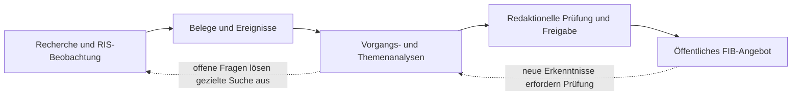

# 01 – Grundlagen, Zielsetzung und Arbeitsweise (Leseentwurf)

**Stand:** 26.10.2026 · **Status:** Lese- und Migrationsentwurf. Die bisherigen fachlichen Primärquellen bleiben bis zum überprüften Regeltransfer verbindlich.

## 01.1 Was ist Feldkirchen im Blick?

**Feldkirchen im Blick (FIB)** ist ein öffentliches Informationsangebot von BÜNDNIS 90/DIE GRÜNEN Feldkirchen. Es führt Informationen aus Rathaus, kommunalen Gremien, Presse und weiteren geeigneten Quellen zusammen, damit Menschen Entwicklungen in Feldkirchen verfolgen und besser verstehen können.

FIB soll **nicht bloß Dokumente sammeln oder einzelne Meldungen aneinanderreihen**. Sein Ziel ist ein verständliches Bild davon, **was sich verändert, wie die Lage einzuschätzen ist, welche Hintergründe relevant sind und was noch offen ist**.

Die redaktionelle politische Herkunft ist transparent. **Sachinformation** und ausdrücklich gekennzeichnete **„Unsere Einordnung“** bleiben voneinander unterscheidbar. Aus grünen Werten darf keine nicht belegte konkrete Position des Ortsverbands abgeleitet werden.

## 01.2 Welchen Nutzen soll das öffentliche Angebot stiften?

Menschen können:
1. unter **Neues** aktuelle Entwicklungen entdecken;
2. bei **Vorgängen** konkrete länger laufende Sachverhalte samt Verlauf und eigenständigem **Vorgangsbeitrag** verstehen;
3. bei **Themen** übergreifende Zusammenhänge anhand des **Themenbeitrags** erkennen;
4. unter **Sitzungen** nachvollziehen, was vorgesehen war, beraten und tatsächlich beschlossen wurde;
5. über **Mehr wissen?** geprüfte Hintergrund- und Erklärungsinformationen erschließen;
6. über die **Suche** und Verknüpfungen zu verwandten Inhalten gelangen.

Ein Vorgangsbeitrag ebenso wie ein Themenbeitrag vermittelt nicht nur einen aktuellen Stand, sondern bei Bedarf Hintergründe, Erklärungen, Wirkungen, Zielkonflikte, Erkenntnisse und offene Fragen. Das öffentliche Angebot nutzt freigegebene redaktionelle Darstellungen und gibt nicht ungeprüft interne Analysen aus.

## 01.3 Welcher Feldkirchen-Bezug ist erforderlich?

Der Gegenstand muss einen **nachvollziehbaren direkten oder begründeten mittelbaren Bezug zu Feldkirchen** aufweisen. Dazu zählen kommunale Entscheidungen und örtliche Auswirkungen ebenso wie regionale Infrastruktur, überörtliche Zuständigkeiten oder Erkenntnisse, die eine konkrete Feldkirchner Fragestellung erklären.

Ein bloß ähnliches Thema ohne sachlichen örtlichen Erklärungs- oder Handlungswert genügt nicht. Die Recherche kann dennoch weiter gefasst sein, um mögliche Zusammenhänge früh zu erkennen. Die operative Suchraum-, Rückblicks- und Relevanzlogik gehört in **Kapitel 03**; die redaktionelle Entscheidung über öffentliche Gewichtung in **Kapitel 08 und 09**.

## 01.4 Wie arbeitet FIB?

Das ist **kein zwingender linearer Produktionsweg**. Meldungen sind optional; einzelne Ereignisse können ohne Vorgang bestehen. Ein neuer Vorgang erhält aus vorhandenen Informationen zunächst eine Analyse, ohne dafür zwingend eine neue Recherche zu starten. Neue Erkenntnisse und Fragen können den Prozess erneut anstoßen.

Die fachlichen Gegenstände und ihre Beziehungen zeigt **Kapitel 02 – Struktur- und Wissensmodell**. **Kapitel 03–07** beschreiben Recherche und Erkenntnisverarbeitung; **08** die Redaktion; **09** das öffentliche Ergebnis; **10** die Qualitätssicherung; **11** Rollen und Befugnisse.

## 01.5 Welche Aufgaben übernimmt KI, welche die Redaktion?

FIB soll mit geringem laufendem Redaktionsaufwand arbeiten: KI beobachtet Quellen, erkennt mögliche Ereignisse, erschließt Belege, bereitet Analysen und Textfassungen vor, entdeckt Unklarheiten und empfiehlt konkrete nächste Schritte.

**Menschen entscheiden verbindlich** über fachlich bestätigte Inhalte, Analyse- und Beitragsfreigaben sowie Veröffentlichung. KI darf vorläufige Ereignisse innerhalb ihrer geregelten Befugnisse automatisch erfassen und weiterverarbeiten; es besteht keine Pflicht, jedes automatisch erfasste Ereignis einzeln zu bestätigen. Bereits redaktionell bestätigte Sachstände werden nicht stillschweigend durch KI ersetzt. Relevante Unsicherheiten werden gezielt zur Entscheidung vorgelegt.

Ein Berechtigungskonzept schützt die fachlichen Entscheidungen und Daten; administrative Rechte sind keine Voraussetzung für normale redaktionelle Freigaben.

**KI-Modellunabhängigkeit ist ein wesentliches Gestaltungsprinzip von FIB.** Fachliche Regeln, Datenbestände, Entscheidungen und Arbeitsabläufe gehören zum System und dürfen nicht von einem bestimmten KI-Anbieter oder Modell abhängen. Verschiedene Modelle sollen je nach Aufgabe eingesetzt, anhand überprüfbarer Qualitätsmaßstäbe verglichen und bei Bedarf ausgetauscht werden können. Wo mehrere Modelle zusammenarbeiten, dient dies der Qualitätssicherung und einem wirtschaftlichen Betrieb – nicht der Verlagerung redaktioneller Verantwortung auf die KI. Einzelheiten stehen in **Kapitel 10** und im bestehenden Dokument `docs/KI-Qualitaet-und-Modellunabhaengigkeit.md`.

## 01.6 Welche Qualitätsansprüche gelten?

- Tatsachenbehauptungen sind mit geeigneten Quellen oder fachlich bestätigtem Erkenntnisstand zu begründen.
- Quelleninhalt, Schlussfolgerung und politische Bewertung bleiben unterscheidbar.
- Erklärungen sind bürgernah, präzise und zugänglich; Fachbegriffe werden bei Bedarf verständlich erläutert.
- Unsicherheit und offene Fragen werden nicht als gesicherte Tatsachen dargestellt.
- Objektiv unzulässige Veröffentlichung wird blockiert; bloße semantische Auffälligkeit führt zur redaktionellen Prüfung.
- Freigegebene und veröffentlichte Versionen bleiben nachvollziehbar; wesentliche Korrekturen werden offengelegt.
- KI-Qualität wird für konkrete Aufgaben getestet; die fachliche Mindestqualität hat Vorrang vor bloßer Kostenersparnis.

Näheres zu Belegprüfung, Freigabesperren und Sprachqualität steht in **Kapitel 10**.

## 01.7 Wie ist dieses Fachhandbuch zu benutzen?

Das Fachhandbuch ist **ablauf- und prozessorientiert**. Das Strukturmodell erläutert die Gegenstände vorab, die Prozesskapitel führen durch typische Aufgaben und Ausnahmen. Geschäftsregeln sind den zuständigen Kapiteln zuzuordnen; sie ergänzen die fachlichen Erklärungen, ersetzen sie aber nicht.

**Ein Sachverhalt – eine verbindliche Primärstelle.** Fachliche Änderungen sind erst abgeschlossen, wenn Entscheidung, Handbuch, betroffene Fachmodelle und Konsistenzprüfung zusammenpassen. Automatisch abgeleitete Begriffssichten und Status-/Rechteübersichten sollen den Zugang erleichtern, aber kein konkurrierendes Regelwerk bilden.

In der laufenden Migration sind die neuen Kapitel **Leseentwürfe**; bestehende Primärquellen sind weiterhin verbindlich. Eine endgültige Ablösung setzt vollständige Regelzuordnung, fachliche Durchsicht, Querverweisprüfung und geeignete Tests voraus.

**Quellen:** `docs/Fachkonzept.md`, `docs/Datenmodell.md`, `docs/UX-und-Informationsarchitektur.md`, `docs/KI-Qualitaet-und-Modellunabhaengigkeit.md`, `docs/Sprachleitfaden.md`, `docs/fachhandbuch/README.md`.
