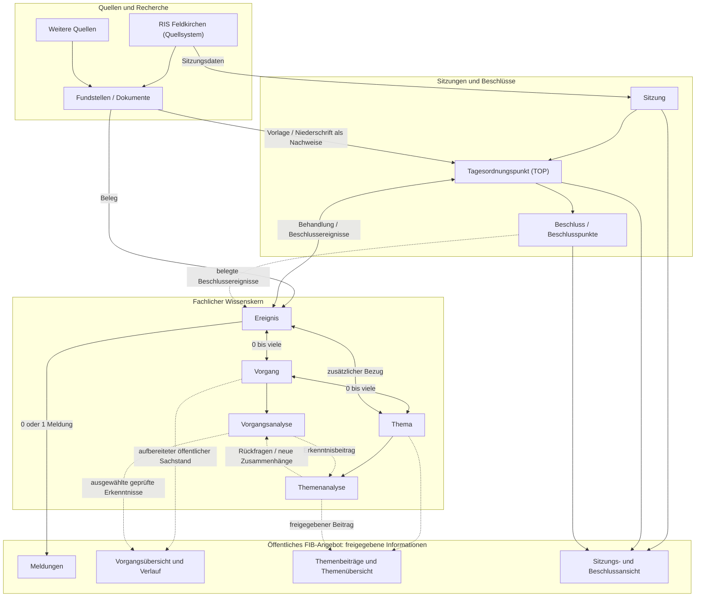

# 02 – Strukturmodell und Wissensmodell (Leseentwurf)

**Stand:** 26.10.2026 · **Status:** Zur fachlichen Durchsicht, keine normative Ablösung des bisherigen Datenmodells.

## 02.1 Wozu FIB die Informationen strukturiert

FIB beobachtet Entwicklungen, gewinnt und prüft Erkenntnisse und bereitet ausgewählte Inhalte zur Veröffentlichung auf. Dafür muss das System unterscheiden zwischen **Quellen und ihren Aussagen**, **Geschehen in der Wirklichkeit**, **längerfristigen Sachverhalten**, **übergreifenden Fragestellungen**, **Analysen** und **öffentlichen Beiträgen**.

Das folgende Modell zeigt die fachlichen Gegenstände und ihre wesentlichen Beziehungen. Es beschreibt **keine Datenbanktabellen** und **keinen starren Ablauf**: Nicht jeder Fund wird ein Ereignis, nicht jedes Ereignis eine Meldung und nicht jede Erkenntnis stammt aus genau einem Ereignis.

## 02.2 Fachliches Strukturmodell auf einen Blick

**Wichtig:** Das öffentliche FIB-Angebot ist **kein einzelnes Datenobjekt**, sondern der Zweck und die Besuchersicht des Systems: Meldungen, Vorgänge, Themen sowie Sitzungen und Beschlüsse sind miteinander navigierbar. Öffentliche Vorgangsansichten verwenden nur entsprechend geprüfte und freigegebene Inhalte; ihr genauer Umfang ist noch fachlich zu bestimmen. Das RIS ist ein externes Quellsystem; Sitzung, TOP und Beschluss sind eigene fachliche Objekte in FIB, nicht nur gewöhnliche Fundstellen.

**Leseschlüssel:** Durchgezogene Linien zeigen stabile fachliche Grundbeziehungen. Gestrichelte Linien zeigen mögliche Erkenntnis-, Recherche- und Bearbeitungsbezüge. Die Bezeichnung `0 bis viele` meint optionale Mehrfachbeziehungen, nicht automatisch bestätigte Zuordnungen. Meldungen sind eigene redaktionelle Darstellungen, nicht die Grundlage der Vorgangs- und Themenanalyse.

### Die Objekte in Alltagssprache

| Objekt | Aufgabe | Beispiel |
|---|---|---|
| **Quelle** | Herkunft von Informationen | Gemeinderats-RIS, Presse, Fachbehörde |
| **Fundstelle** | konkrete auffindbare Information bzw. Dokument mit Nachweis | Beschlussvorlage, Presseartikel, Fachstudie |
| **Ereignis** | sachlich relevante Entwicklung | Gemeinde fasst einen Beschluss |
| **Meldung** | optionaler öffentlicher Bericht über ein Ereignis | Kurzmeldung zum Beschluss |
| **Vorgang** | länger andauernder konkreter Sachverhalt, verbindet Ereignisse | Parkraumkonzept Feldkirchen |
| **Vorgangsanalyse** | erklärt und bewertet den überprüfbaren Sachstand eines Vorgangs | Ziele, Ursachen, Wirkungen, Unsicherheiten |
| **Thema** | übergreifende Fragestellung mit eigenen Erkenntniszielen | Mobilität in Feldkirchen |
| **Themenanalyse** | verknüpft Erkenntnisse aus Vorgängen, Belegen und Hintergrundwissen; gewinnt eigenständige Schlüsse | Wechselwirkungen verschiedener Verkehrsprojekte |
| **Themenbeitrag** | redaktionell ausgewählte, öffentliche Darstellung auf Grundlage der Themenanalyse | Bürgernaher Überblick mit optionaler Einordnung |

## 02.2a RIS, Sitzungen und öffentlicher Zugang

Im bisherigen Fachmodell sind **Sitzung, Tagesordnungspunkt (TOP), Beschlussvorschlag, Beschlusspunkt, Beschlussfassung, Abstimmung und Niederschrift** bereits ausdrücklich definiert. Die Vorlage ist als Dokument eine Fundstelle; deren Veröffentlichung kann ein Ereignis auslösen. Die spätere Beratung und ein tatsächlicher Beschluss sind davon getrennte Ereignisse. Aus diesen Beziehungen ergeben sich die Navigationswege **Sitzung → TOP → Ereignis → Vorgang/Thema** und zurück. Grundlage: `docs/Sitzungs-und-Beschlussmodell.md`.

Die öffentliche Ansicht sollte erkennbar machen, wie ein Beschluss zu einem laufenden Vorgang gehört und welche Entwicklung ihm vorausging. Auch ein Vorgang soll von seiner öffentlichen Übersicht zu verbundenen Meldungen, Sitzungen, Quellen und Themen führen können. Bereits im bestehenden Navigationskonzept sind **Meldungen, Vorgänge, Themen und Sitzungen** als eigenständige Inhaltsbereiche vereinbart. Die genaue Gestaltung und die notwendige öffentliche Freigabe der Vorgangsinhalte sind in Kapitel 09 noch zu präzisieren.

### Öffentlichkeitslogik: Meldung und Vorgang

**Zur fachlichen Entscheidung vorgeschlagen:** Eine veröffentlichte Meldung, die zu einem Vorgang gehört, wird **nicht ausschließlich im Vorgang versteckt**. Sie ist über die aktuelle Meldungsübersicht auffindbar und zugleich im chronologischen Verlauf der öffentlichen Vorgangsansicht eingebunden. Das ist **eine Meldung mit zwei Zugangswegen**, keine Verdoppelung des Datensatzes; die Beziehung wird über Meldung → Ereignis → Vorgang abgeleitet. Mehrere Meldungen desselben Vorgangs können in der aktuellen Übersicht zugunsten der Übersichtlichkeit gruppiert werden. Die konkrete öffentliche Listen- und Gruppierungslogik wird in Kapitel 09 festgelegt.

### RIS: Ausgangsinformationen, Fundstellen und FIB-Objekte

Das externe **RIS** liefert einerseits **Sitzungsdaten** (Sitzung, Gremium, TOP/Agenda), andererseits **Dokumente als Fundstellen** (Beschlussvorlage, Niederschrift, gegebenenfalls weitere Unterlagen). Die strukturierten FIB-Objekte **Sitzung, TOP, Beschlusspunkt und Abstimmung** beruhen auf diesen nachgewiesenen Angaben.

- **Beschlussvorlage:** Fundstelle; ihre Veröffentlichung ist gegebenenfalls ein eigenes Ereignis, **nicht** der später tatsächlich gefasste Beschluss.
- **Niederschrift:** Fundstelle der Sitzung, aus der FIB die tatsächliche TOP-Behandlung, abgestimmte Beschlussfassung und Abstimmungsergebnisse erschließt. Diese Informationen gehören zu entsprechenden Behandlungs-/Beschlussereignissen.
- **Öffentliche Sitzungs-/Beschlussansicht:** stellt Sitzung, TOP, tatsächlich beschlossenen Text, Abstimmung, Beziehung zu Vorgang/Thema und den Originalvorschlag zusammen. Eine Datei wird nicht allein aufgrund ihrer Auffindbarkeit im RIS von FIB erneut öffentlich bereitgestellt; dafür gelten die bestehenden Rechteprüfungen.
- **Navigation:** Sitzung → TOP → Ereignis → Vorgang/Thema und zurück. Öffentliche Meldungsbezüge werden über das Ereignis abgeleitet, nicht als eigenständige doppelte Zuordnung an TOP oder Sitzung gespeichert.

Die Linien zu Sitzung und TOP im Diagramm sind deshalb bewusst **durchgezogen**, wo das RIS strukturierte Sitzungsdaten liefert und Dokumente den TOP belegen. Das ist eine fachliche Informationsherkunft, keine Behauptung, dass FIB jede RIS-Information unverändert übernehmen darf.

## 02.3 Drei Beziehungen, die man nicht verwechseln darf

**Ereignis ↔ Meldung:** Zu einem Ereignis kann es **keine oder genau eine Meldung** geben; die Meldung bezieht sich auf genau ein Ereignis. Das ist eine bereits geltende Kardinalitätsregel des bisherigen Datenmodells. Sie hindert nicht daran, dass ein späteres **neues Ereignis** eine eigene Folgemeldung erhält.

**Ereignis ↔ Vorgang:** Ein Ereignis kann mehreren konkreten Vorgängen zugeordnet sein, falls diese tatsächlich betroffen sind. Ein Vorgang umfasst grundsätzlich mehrere Ereignisse im Verlauf; das bisherige Modell erlaubt fachlich mindestens ein zugeordnetes Ereignis. Ein Vorgang ist **nicht** bloß eine Sammlung von Meldungen.

**Vorgang ↔ Thema:** Ein Thema kann mehrere Vorgänge verknüpfen; ein Vorgang kann mehrere Themen betreffen. Einzelne zusätzliche Ereignisse können direkt einem Thema zugeordnet werden. Fachlich relevante Ereignisse werden nicht doppelt gezählt, nur weil sie über mehrere Pfade sichtbar werden.

## 02.4 Wo das Wissen liegt

Wissen entsteht nicht erst mit einer öffentlichen Meldung: Die **Analyse** ist der interne fachliche Erkenntnisstand. Sie unterscheidet Fakten, Erklärungswissen, Hintergründe, konkrete Wirkungen, übergreifende Schlussfolgerungen sowie Unsicherheiten und offene Fragen.

Eine konkrete Wirkung wird – sofern zutreffend – mit ihrem Ereignisbezug dokumentiert. **Eine übergreifende Schlussfolgerung muss dagegen nicht künstlich an ein einzelnes Ereignis gebunden werden.** Sie gehört unmittelbar zur Vorgangs- oder Themenanalyse und wird durch Quellen und nachvollziehbare Herleitungen gestützt.

Beispiel: Einzelereignisse betreffen Autobahnkreuz, Parkraum und Radverkehr. Die Themenanalyse kann zusätzlich untersuchen, **wie diese Planungen zusammenwirken**. Diese Aussage ist mehr als die Wiederholung einer Einzelwirkung.

**Offener Modellierungsaspekt:** Die bestehende Struktur für ereignisbezogene Wirkungen muss um den fachlichen Platz für solche übergreifenden Erkenntnisse ergänzt oder mit ihm abgeglichen werden. Diese Vorschau legt keine neuen Tabellen oder technischen Schlüssel fest.

## 02.5 Recherche ist mit dem Wissensmodell verbunden

Die laufende Recherche beobachtet Quellen und erkennt mögliche neue Fundstellen und Ereignisse. Daneben können **Vorgangs- oder Themenanalysen** neue Fragen auslösen. Daraus folgen gezielte Rechercheaufträge, deren Ziel und Umfang die Redaktion genehmigt. Wiederkehrende Beobachtungsaufträge sind davon zu unterscheiden; jeder konkrete Recherchelauf ist nachvollziehbar.

**Auch ohne neuen Rechercheauftrag** darf FIB vorhandene Informationen für eine erste Analyse eines neuen Vorgangs auswerten. Neue Erkenntnisse können bestehende Analysen und Veröffentlichungen zur erneuten Prüfung stellen.

## 02.6 Vorläufig, geprüft, freigegeben und veröffentlicht

Diese Begriffe bezeichnen **verschiedene Ebenen** und dürfen nicht als ein einziger Status vermischt werden.

- **Vorläufig:** Eine KI darf ein neues Ereignis erfassen, zuordnen und auswerten; nicht jedes Ereignis benötigt eine redaktionelle Einzelbestätigung.
- **Bestätigt:** Ein redaktionell bestätigtes Ereignis oder eine bestätigte Beziehung ist gegen eigenmächtiges KI-Überschreiben geschützt.
- **Analysefreigabe:** Die Redaktion bestätigt den geprüften Erkenntnisstand ganz oder teilweise; dadurch ändert sich **nicht** der Themenstatus.
- **Beitragsfreigabe:** Die Redaktion bestätigt eine konkrete Fassung eines öffentlichen Texts. Die **erste Beitragsfreigabe** führt beim Thema von Entwurf nach Aktiv.
- **Veröffentlichung:** Eine eigene Entscheidung macht genau diese Fassung öffentlich; sie kann nach den noch zu spezifizierenden Terminregeln zeitgesteuert erfolgen.

Jede öffentliche Korrektur erfolgt nachvollziehbar und nicht als stillschweigende Textüberschreibung.

## 02.7 So liest man dieses Modell zusammen mit dem Handbuch

- Kapitel **03 Recherche**: Wie entstehen Fundstellen, neue Informationen und gezielte Nachrecherchen?
- Kapitel **04 Ereignisse/Meldungen**: Wie wird Geschehen erkannt und gegebenenfalls berichtet?
- Kapitel **05 Vorgänge**: Wie wird ein konkreter Sachverhalt analysiert und fortgeschrieben?
- Kapitel **06 Themen**: Wie entstehen übergreifende Erkenntnisse und der Themenbeitrag?
- Kapitel **08 Redaktion**: Wer entscheidet wann?
- Kapitel **10 Qualität**: Was wird geprüft, wann blockiert FIB und wann weist FIB nur hin?

Das Strukturmodell gehört **an den Beginn des Handbuchs**, unmittelbar nach Zweck und Grundsätzen, und wird in den Prozesskapiteln nur noch **ausschnittweise** erläutert. Damit bleibt die Dokumentation prozessorientiert, ohne die Objektzusammenhänge zu verstecken.

## 02.8 Noch abzugleichende Detailregeln

Dieses Kapitel ist eine **Lesefassung**, noch keine vollständige Übernahme von `docs/Datenmodell.md`, `docs/Persistenz-und-Lebenszyklusmodell.md` oder den spezialisierten Primärquellen. Vor normativer Ablösung sind insbesondere Analysebestandteile, Teilfreigaben, Vorläufigkeit der Ereignisse, Status-/Rechtekataloge, Veröffentlichungsversionen und Rechercheobjekte vollständig regelweise zu migrieren.

**Basisquellen:** `docs/Datenmodell.md`, `docs/Themen-und-Vorgangslogik.md`, `docs/fachhandbuch/README.md`; ergänzend die Migrationsentwürfe zu 03–06, 08 und 10 sowie die vier Fachentscheidungen vom 26.10.2026.
