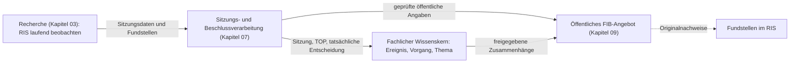

# 07 – Sitzungen und Beschlüsse (fachlicher Lese- und Migrationsentwurf)

**Stand:** fachlich abgenommen am 29.10.2026; technischer Nachweis ergänzt am 31.10.2026. Der historische Dateiname ändert die Geltung nicht; siehe [verbindlichen Handbuchstand](README.md).

## 07.1 Aufgabe und Abgrenzung

FIB soll politische Beratungs- und Entscheidungsabläufe im Gemeinderat nachvollziehbar machen: **Was wird beraten, was ist vorgeschlagen, was ist tatsächlich geschehen und beschlossen worden – und was bedeutet das für einen Vorgang oder ein Thema?**

Das Ratsinformationssystem (RIS) ist dafür eine maßgebliche **externe Quelle**. Die laufende Beobachtung neuer und geänderter RIS-Informationen ist Teil der **allgemeinen Recherche** (Kapitel 03), keine zweite unabhängige Recherche. Dieses Kapitel behandelt dagegen die **eigene fachliche Verarbeitung** des kommunalen Verfahrens. Die öffentliche Darstellung erfolgt über Kapitel 09.

**Aufgabenteilung auf einen Blick:**

## 07.2 Welche RIS-Informationen wohin gehören

FIB unterscheidet zwei **ergänzende Sichtweisen auf dieselben RIS-Inhalte**:

| RIS-Inhalt | Fachliche Rolle in FIB |
|---|---|
| Sitzungstermin, Gremium, Sitzungskennung | Strukturierte **Sitzung** |
| Tagesordnung, TOP-Nummer und Beratungsgegenstand | Strukturierter **TOP**; Hinweis, was vorgesehen ist |
| Beschlussvorlage und Anlagen | **Fundstellen** für Vorschlag, Sachverhalt und Begründung |
| Veröffentlichte Niederschrift | **Fundstelle** für tatsächlichen Sitzungsverlauf, Beschlussfassung und Abstimmung |
| Tatsächlich beschlossener Text | **Beschlusspunkt/Fassung**, ausschließlich durch RIS-Unterlagen zum betreffenden TOP belegt |
| Abstimmungsergebnis | **Abstimmung**, mit beschlossener Fassung und Nachweis verknüpft |

Die Sitzung und ihre TOPs sind eigenständige fachliche Objekte. **Eine Vorlage ist eine Fundstelle, nicht bereits der Beschluss.** Eine Niederschrift kann als Beleg für mehrere Beschlusspunkte dienen. Für TOP-bezogene Beschlussvorlagen und Niederschriften soll FIB **neben URL und Herkunft den vollständigen erschlossenen Dokumenttext** dauerhaft verfügbar halten, damit der Inhalt trotz störanfälliger RIS-PDF-Links und wechselnder Browserunterstützung lesbar und recherchierbar bleibt. **Interne Speicherung und öffentliche Wiedergabe des Volltexts sind jedoch getrennte Rechtefragen:** Die öffentliche FIB-Anzeige erfolgt nur, soweit hierfür eine belastbare rechtliche Grundlage oder Nutzungsbefugnis besteht. Bis dahin werden belegte Sachinformationen, zulässige Auszüge und der Original-Link verwendet. **Anlagen Dritter** (beispielsweise Gutachten) werden nicht automatisch vollständig übernommen oder über FIB öffentlich wiedergegeben; FIB führt grundsätzlich ihren Quellenlink und die erforderlichen Metadaten. Die bloße öffentliche Abrufbarkeit einer PDF rechtfertigt nicht automatisch ihre erneute öffentliche Bereitstellung durch FIB.

## 07.3 Fachlicher Ablauf

### 1. Sitzung und Tagesordnung erkennen

Die Recherche erkennt eine Sitzung, ihren Termin, das Gremium und die zugehörigen TOPs. **Nur einem konkreten TOP zugeordnete Beschlussvorlagen werden in den FIB-Sitzungsbestand übernommen.** Frei zugängliche Vorlagen ohne TOP-Zuordnung werden im Rahmen dieses fachlichen Sitzungsprozesses nicht erfasst. Das Sitzungsmodell erfasst bzw. aktualisiert diese Informationen. Die Agenda kündigt einen Gegenstand an, beweist aber nicht dessen spätere Behandlung oder Beschlussfassung. Ein bereits bekannter Vorgang kann so frühzeitig eine anstehende Befassung erhalten.

### 2. Vorlagen und Anlagen erschließen

FIB verknüpft die Beschlussvorlage als Fundstelle mit dem passenden TOP. Aus ihr erschließt FIB den **Vorschlag**, einschließlich möglicher Entscheidungsalternativen und Begründungen. Die Veröffentlichung eines dem TOP zugeordneten Beschlussvorschlags kann ein eigenes Ereignis sein und damit Vorgänge und Themen fachlich fortschreiben; **sie löst für sich genommen regelmäßig keine Meldung aus**. Eine spätere tatsächliche Beschlussfassung ist ein weiteres Ereignis. Eine Meldung zu einer wichtigen Entscheidung ist möglich, insbesondere wenn sie für einen bestehenden Vorgang berichtenswert ist. Die Meldung wird über ihr Ereignis automatisch im betreffenden Vorgangsverlauf sichtbar. Es entsteht daraus noch **kein tatsächlich gefasster Beschluss**.

### 3. Beratung und tatsächliche Entscheidung nachvollziehen

Wenn belastbare Informationen über die stattgefundene Sitzung vorliegen, erfasst FIB die tatsächlichen Verfahrensschritte. **Ausschließlich aus den einschlägigen RIS-Angaben**, insbesondere der Niederschrift, werden die wirklich zur Abstimmung gestellten Beschlusspunkte, ihre Fassungen und zugehörigen Abstimmungsergebnisse erschlossen. **Vorlage und Beschlussfassung sind getrennte Entwicklungen**; Ausfälle, Vertagungen und Absetzungen dürfen nicht als Annahme des Vorschlags erscheinen.

### 4. Vorlage mit Beschluss vergleichen

FIB stellt gegenüber, was ursprünglich vorgeschlagen und was später tatsächlich beschlossen wurde. Falls ein Beschluss verändert, in Teilen oder anders strukturiert angenommen wurde, muss diese Abweichung nachvollziehbar bleiben. Eine starre 1:1-Abbildung einzelner Vorlagenabsätze auf Beschlusspunkte wird nicht vorausgesetzt.

### 5. Wirkungen auf Ereignisse, Vorgänge und Themen prüfen

Beschlussvorschlag, tatsächliche Beschlussfassung und spätere Veröffentlichung der Niederschrift sind **unterscheidbare Ereignisse**, soweit sie fachlich relevant sind. Sie bleiben für Vorgänge und Themen auswertbar, auch wenn keine Meldung entsteht. Eine wichtige Beschlussfassung kann eine Meldung begründen und darüber automatisch im zugehörigen Vorgang erscheinen. **Die Veröffentlichung der Niederschrift löst ebenfalls eine Meldungsprüfung aus**; dabei wird der tatsächliche Erkenntnisgewinn berücksichtigt, damit nicht lediglich ein bereits zuverlässig berichteter Beschluss doppelt gemeldet wird. Neue Entscheidungen können Vorgangsanalysen und Themenbeiträge aktualisierungsbedürftig machen. Diese Prüfung nutzt das allgemeine Änderungspaket- und Freigabemodell; Kapitel 07 erzeugt keine unabhängige zweite Redaktion.

### 6. Informationen für das öffentliche FIB-Angebot bereitstellen

Öffentliche Sitzungsansichten erschließen Sitzung, TOP, relevante Beschlussfassung und Abstimmungsergebnis sowie Links zum ursprünglichen Vorschlag und den zugehörigen Vorgängen/Themen. Ob zusätzlich eine Meldung sinnvoll ist, entscheidet der allgemeine Meldungsprozess; nicht jeder TOP erzeugt automatisch eine Meldung.

### Fachlicher Detailablauf: Vom Vorschlag zum nachgewiesenen Beschluss

Eine Beschlussvorlage beschreibt zunächst die **beabsichtigte Entscheidung**. FIB behandelt sie als Fundstelle und – sofern relevant – ihre Veröffentlichung als eigenes Ereignis. Die Zuordnung zu einer Sitzung und einem Tagesordnungspunkt macht aus dem Vorschlag noch keinen Beschluss.

| Zeitpunkt | Fachlicher Gegenstand | Was FIB festhalten darf |
|---|---|---|
| Vorlage erscheint | Dokument und Veröffentlichungsereignis | vorgeschlagene Maßnahme, Ausgangsfassung, Quellen- und Datumsnachweis |
| Tagesordnung wird veröffentlicht oder geändert | Sitzung und TOP | vorgesehene Behandlung, Tagesordnungsstand und Veränderung; kein fingiertes Abstimmungsergebnis |
| Sitzung findet statt | tatsächliche Beratung/Behandlung | nur mit geeigneten Belegen bestätigter Sitzungsverlauf; ohne Nachweis bleibt Ergebnis offen |
| Bekanntgabe oder Niederschrift | tatsächliche Beschlussfassung | beschlossener Wortlaut, Beschlusspunkte, Abstimmungen und Quelle nur soweit belegt |
| Berichtigung oder genehmigte Niederschrift | aktualisierter Nachweis | ursprüngliche Aussage, Änderung, Zeitpunkt und Herkunft bleiben nachvollziehbar |

**Mehrere Beschlusspunkte** eines TOPs können unterschiedliche Entscheidungen enthalten. Auch **mehrere Abstimmungen** zu einem Tagesordnungspunkt sind kein Widerspruch, sondern müssen der jeweils betroffenen Fassung oder dem jeweiligen Beschlusspunkt zugeordnet werden. Die ursprünglich vorgesehene Fassung darf dabei nicht durch den letztlich beschlossenen Wortlaut ersetzt werden.

**Niederschrift und Genehmigung:** Eine zunächst vorläufige Niederschrift ist als solcher Quellenstand kenntlich zu machen; ihre spätere Genehmigung oder Berichtigung ist eine weitere, nachvollziehbare Entwicklung. **Externe Presseberichte über die Sitzung**, etwa aus dem Münchner Merkur, werden **nur der Sitzung als Ganzes** zugeordnet und dort als informelle Berichterstattung angezeigt, **nicht einzelnen TOPs oder Beschlusspunkten**. Sie dürfen eine redaktionell geprüfte allgemeine Sitzungsmeldung anregen, **aber weder TOP-Status noch Beschlusswortlaut, Beschlusspunkte oder Abstimmungsergebnisse fachlich konkretisieren oder bestätigen**. Diese TOP-spezifischen Angaben stammen ausschließlich aus dem RIS. Sobald RIS-Nachweise vorliegen, werden sie eigenständig ausgewertet. Eine Differenz zur Presseberichterstattung wird als Quellenunterschied kenntlich, ohne amtliche TOP-Daten aus dem Presseartikel abzuleiten.

**Beispiel:** Beim Grundstückskauf der Gemeinde Feldkirchen enthält die Vorlage einen Beschlussvorschlag. Erst wenn ein geeigneter Nachweis zur Sitzung vorliegt, kann FIB berichten, ob und mit welcher Fassung darüber entschieden wurde. Änderungen des Kaufgegenstands oder der Bedingungen sind als Unterschied zwischen vorgeschlagenem und beschlossenem Stand zu beschreiben.

Diese Erläuterung konkretisiert das bisherige [Sitzungs- und Beschlussmodell](../Sitzungs-und-Beschlussmodell.md). Die dortigen differenzierten Detailregeln zu Status und Verfahrensereignissen bleiben bis zur vollständigen normativen Migration die maßgebliche Bestandsquelle.

## 07.4 Wichtige fachliche Sicherungen

- Bei unsicherer Zuordnung von Niederschrifteninhalten zu TOPs, Vorlagen oder Beschlusspunkten schlägt FIB eine **redaktionelle Prüfung** vor und übernimmt strittige Zuordnungen nicht stillschweigend.
- **Genehmigung einer Niederschrift** und **öffentliche Verfügbarkeit ihres Dokuments** sind verschiedene Sachverhalte. Eine Sitzung kann fachlich abgeschlossen sein, obwohl eine genehmigte Niederschrift nicht öffentlich als PDF vorliegt.
- Frühere Fassungen und Belege werden nachvollziehbar erhalten. Ein späterer amtlicher Nachweis kann eine frühere Presseinformation bestätigen, ergänzen oder berichtigen.
- Beziehungen **Meldung → Ereignis → TOP/Sitzung** werden abgeleitet, nicht als zweite unabhängige Meldungs-TOP-Zuordnung erfasst.
- Jede öffentliche Datei- oder Bildbereitstellung unterliegt zusätzlich den allgemeinen Rechte- und Freigaberegeln.

### Weitere fachliche Regeln zum Sitzungsverlauf

TOP-Status und Abstimmungsergebnis sind verschieden. FIB unterscheidet angekündigte, vertagte, behandelte und abgesetzte Tagesordnungspunkte. Zwischen TOP und Ereignis sind mehrere begründete Beziehungen zulässig.

Aus einer veröffentlichten Vorlage entstehen noch keine bestätigten Beschlusspunkte oder Abstimmungen. **Externe Presseberichte dürfen keinen vorläufigen TOP-Beschlussstand erzeugen.** Sie erscheinen ausschließlich als informelle Berichterstattung zur Sitzung insgesamt. Die fachliche Konkretisierung eines TOPs und die Erfassung von Beschlusswortlaut, Beschlusspunkten und Abstimmungen erfolgen nur mit RIS-Nachweisen, auch wenn diese erst später bereitgestellt werden. Bei mehreren Abstimmungen bleiben Beschlusspunkt, seine unterschiedlichen Fassungen und Abstimmungsergebnisse nachvollziehbar. Der Ausgangsvorschlag bleibt zum Vergleich erhalten.

Zweifelhafte Zuordnungen zu TOP, Ereignis, Abstimmung oder Beschlusstext müssen redaktionell geprüft werden und werden nicht automatisch fachlich wirksam.

Für einen fachlich abgeschlossenen Sitzungsstand ist die öffentlich belegte Genehmigung der Niederschrift maßgeblich. Das ist von der öffentlichen Verfügbarkeit des Dokuments zu unterscheiden. Quelle: [Sitzungs- und Beschlussmodell](../Sitzungs-und-Beschlussmodell.md), Abschnitte 4 bis 8.

### Wie Sitzungen, Meldungen, Vorgänge und Themen zusammenhängen

Die öffentliche Sitzungsansicht wird **aus den bereits bestätigten Fachbeziehungen erschlossen**. Ein Tagesordnungspunkt gehört zu einer Sitzung und kann mit einem oder mehreren Ereignissen verbunden sein. Über diese Ereignisse lassen sich zugehörige Meldungen, Vorgänge und Themen finden. Die Redaktion muss diese Beziehungen nicht ein zweites Mal an der Sitzung pflegen.

- **Meldungen:** Der Bezug zur Sitzung oder zu einem TOP entsteht über **Meldung → Ereignis → TOP → Sitzung**; bei sitzungsweiten Ereignissen gegebenenfalls direkt über Ereignis → Sitzung. Es gibt keine zusätzliche verbindliche Zuordnung Meldung–TOP oder Meldung–Sitzung.
- **Vorgänge und Themen:** Die Verbindung entsteht über **TOP → Ereignis → Vorgang → Thema** beziehungsweise über einen begründeten direkten Ereignis–Thema-Bezug. Beide Navigationsrichtungen müssen möglich bleiben.
- **Öffentlicher Beschluss:** Im Vordergrund stehen der tatsächlich abgestimmte Wortlaut, das Abstimmungsergebnis, Sitzung und TOP. Der ursprüngliche Beschlussvorschlag bleibt als Vergleich nachvollziehbar zugänglich, sofern vorhanden.
- **Herkunft und Verlauf:** Es muss nachvollziehbar sein, welches Ereignis welchem TOP zugeordnet wurde, welche Beschlussfassungen tatsächlich abgestimmt wurden und welche späteren Ereignisse denselben Sachverhalt betreffen. Presseberichte zur Sitzung sind davon getrennt als **sitzungsbezogene externe Fundstellen** sichtbar und erhalten keine TOP-Zuordnung.

**Beispiel:** Ein Besucher öffnet einen Tagesordnungspunkt zum Parkraumkonzept. Er kann den dokumentierten Beschluss mit Abstimmung sehen, den ursprünglichen Vorschlag vergleichen und zum zugehörigen Vorgang sowie dessen Meldungen wechseln. Eine Meldung erhält dadurch **keine zweite unabhängige Zuordnung** zur Sitzung.

Diese Regeln stammen aus dem [Sitzungs- und Beschlussmodell](../Sitzungs-und-Beschlussmodell.md), §§9–11. Die Gestaltung der Verlinkungen und der Beschlussansicht wird erst in der nächsten UI-Phase entschieden.

## 07.5 Abnahmeszenarien

1. RIS veröffentlicht TOP mit Vorlage: FIB zeigt den vorgesehenen Beratungspunkt, **noch keinen Beschluss**.
2. Sitzung behandelt TOP nicht: keine falsche Beschlussmeldung.
3. Niederschrift enthält vom Vorschlag abweichende beschlossene Fassung: FIB zeigt Originalvorschlag, beschlossene Fassung und Abstimmung getrennt.
4. Niederschrift ist noch nicht verfügbar: FIB kennzeichnet Unsicherheit bzw. den vorläufigen Informationsstand, ohne die tatsächliche Entscheidung zu erfinden.
5. Ein TOP betrifft Parkraumkonzept und Mobilitätsthema: FIB verknüpft die Information über das Ereignis mit Vorgang und Thema.
6. Späterer RIS-Nachweis korrigiert einen früheren Pressebericht: Änderungsvorschlag mit prüfbaren Belegen und ggf. Korrekturaufgabe für öffentliche Inhalte.
7. RIS veröffentlicht eine Vorlage **ohne TOP**: keine systematische Erfassung als Beschlussvorlage im Sitzungsbestand; keine erfundene Sitzung oder Beschlussfassung.
8. Ein Merkur-Bericht erscheint unmittelbar nach der Sitzung: FIB ordnet ihn **nur der Sitzung** zu, zeigt ihn als externe Berichterstattung und prüft eine allgemeine Sitzungsmeldung; **keine** automatische TOP-Zuordnung, kein vorläufiger Beschlusspunkt und kein Abstimmungsergebnis aus dem Bericht.
9. Eine TOP-bezogene Vorlage ist im Originalbrowser nicht lesbar: FIB hält den erschlossenen vollständigen Text mit URL und Provenienz vor; öffentliche Volltextanzeige erfolgt nur bei geklärter Befugnis. Gutachten Dritter werden nicht automatisch gespiegelt.
10. Veröffentlichung einer Niederschrift zu bereits gemeldetem Beschluss: neues Ereignis und erneute Prüfung auf neuen Informationswert, aber keine doppelte Meldung ohne sachliche neue Aussage.

## 07.6 Übergabe und offene Migration

- **Kapitel 03:** Wann und wie RIS beobachtet wird; Fundstellen- und Änderungserkennung, Quellenlücken und Rechercheausführung.
- **Kapitel 07 (hier):** Sitzungs-, TOP-, Vorlagen-, Niederschriften-, Beschlusspunkt- und Abstimmungslogik.
- **Kapitel 04/05/06:** Ereignisse, Vorgänge und Themen als fachliche Folgewirkungen.
- **Kapitel 08/10:** Redaktionelle Entscheidungen, Rechte und Qualitätssicherung.
- **Kapitel 09:** Öffentliche Sitzungsnavigation und Darstellungsregeln.

**Stand des fachlichen Quellabgleichs:** Die wesentlichen Regeln aus `docs/Sitzungs-und-Beschlussmodell.md` §§3–11 sind in diesem Prozesskapitel erklärt: Ereignisidentität, TOP-Zustände und -Beziehungen, Beschlusspunkte/Fassungen/Abstimmungen, Unsicherheitsprüfung, Niederschriftgenehmigung sowie öffentliche Navigation und Vergleich mit dem Ursprungsvorschlag. **Noch nicht abgeschlossen** ist der nachweisbare Einzelabgleich jeder Detailaussage, ihrer Quellenverweise und möglicher Sonderfälle; bis zur normativen Migration bleibt die Ursprungsquelle erhalten. Die technische RIS-Anbindung (Abfragefrequenz, Änderungsabgleich, Fehlerbehandlung und Aktualitätsnachweis) folgt in einer späteren Implementierungsphase.

## Technischer Integrationsnachweis – 31.10.2026

[U4 RIS-Persistenz](../operations/u4-ris-persistence.md) dokumentiert die technische
Abbildung der bestehenden Regeln auf Versionen, Belege und redaktionelle Aktionen.
Der [Abnahmebericht](../operations/u4-reference-sources-acceptance.md) trennt
isoliert geprüfte Funktionen, offene Technik, UI-Abnahme und spätere Betriebsqualität.
Die Umsetzung begründet keine automatische Gleichsetzung von Vorlage und Beschluss
und keine allgemeine Pflichtprüfung jeder Fundstelle. Die fachlichen Regeln bleiben
unverändert; produktive Bereitstellung ist nicht Bestandteil dieses Nachweises.
