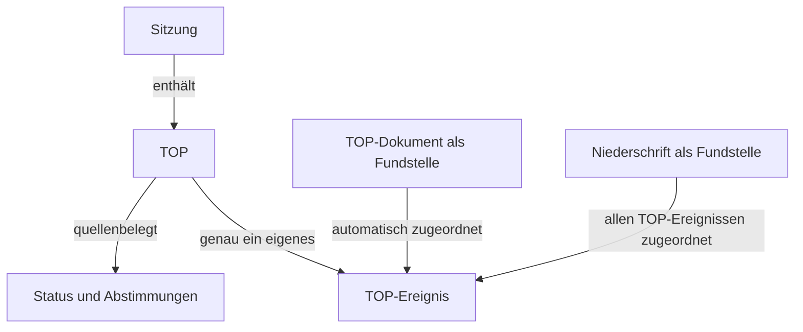

# 07 – Sitzungen und Beschlüsse

**Stand 11.11.2026.** Der hier beschriebene RIS-Funktionsumfang wurde auf Desktop und in Firefox bei 412 px fachlich abgenommen. Grundlage sind [Issue #427](https://github.com/PustefixReisen/fib-echtsystem/issues/427), die Umsetzung in PR #422, #424 und #426 sowie die Nacharbeiten #423 und #425. Die Abnahme umfasst die RIS-Übernahme und ihre Redaktionsansicht. Die Freigabe des allgemeinen Betriebs und der Sicherheit wird gesondert behandelt.

## 07.1 Aufgabe und Geltung

FIB macht die öffentlichen Gemeinderatssitzungen mit Tagesordnung und belegten Ergebnissen zugänglich. Das amtliche Ratsinformationssystem ist die Quelle. Die Recherche beobachtet es im gemeinsamen Quellenprozess aus [Kapitel 03](03-Recherche.md). Dieses Kapitel regelt die automatische Übernahme, die Beziehung zu Fundstellen und Ereignissen und die abgenommene Sitzungsansicht.

Die Redaktion liest den amtlichen Stand und verwendet ihn für ihre weitere Arbeit. Sie kann importierte Sitzungen, TOPs, Dokumentdaten, Ergebnisse und ihre automatisch erzeugten Beziehungen weder bearbeiten noch ergänzen. Aktualisierungen erfolgen durch erneute Erfassung der amtlichen Quelle. Ein Fehlerhinweis veranlasst eine technische Prüfung der Erfassung und ihrer Herkunft.

Dieses Kapitel ersetzt die früheren Regeln zur redaktionellen RIS-Erschließung, zu Sitzungsereignissen, zusätzlichen TOP-Ereigniszuordnungen, kopierten Beschlussfassungen und manuellen Analysefreigaben. Der frühere Regelstand ist in der Git-Historie nachvollziehbar.

## 07.2 Fachobjekte und Beziehungen

| Gegenstand | Bedeutung und Beziehung |
|---|---|
| Sitzung | Gremium, Datum, Sitzungskennung und Originaladresse. Eine Sitzung enthält ihre öffentlichen TOPs. |
| TOP | Gehört genau einer Sitzung an und behält seine amtliche Nummer und seinen Titel. Jeder importierte TOP erhält genau ein eigenes TOP-Ereignis. |
| TOP-Ereignis | Automatisch erzeugtes, redaktionell nicht bearbeitbares FIB-Ereignis. Sein Titel entspricht dem TOP-Titel ohne angehängten Beschlussstatus, sein Ereignisdatum dem Sitzungsdatum. Es gehört genau diesem TOP. |
| Beschlussvorlage und weitere TOP-Dokumente | Amtliche Dokumente werden als Fundstellen nachgewiesen und dem zugehörigen TOP-Ereignis automatisch zugeordnet. |
| Sitzungsniederschrift | Eine Fundstelle für die Sitzung, automatisch mit allen TOP-Ereignissen dieser Sitzung verbunden. Sie wird dafür nicht je TOP als neues Dokument angelegt. |
| Beschlussergebnis | Belegter Status und verfügbare Stimmenzahlen. Je TOP sind mehrere getrennte Abstimmungen möglich. Ihre Herkunft bleibt bis zur Niederschrift nachvollziehbar. |
| Meldung, Vorgang und Thema | Redaktionelle Folgeobjekte nach den Kapiteln 04–06 und 08. Sie sind von den importierten RIS-Daten und ihren geschützten Beziehungen getrennt. |

Eine Sitzung erhält kein eigenes Ereignis. Weitere oder sitzungsfremde Ereignisse werden einem TOP nicht zugeordnet. Auch Veröffentlichung der Vorlage, spätere Niederschrift und einzelne Abstimmungen erzeugen keine zusätzlichen Ereignisse zu demselben TOP.

Externe Presseberichte durchlaufen den allgemeinen Fundstellen- und Redaktionsprozess. Sie können dort eigene Sachverhalte und Bezüge zu Vorgängen oder Themen begründen. Sie ergänzen weder den amtlichen Sitzungsbestand noch die Fundstellenzuordnungen des geschützten TOP-Ereignisses. TOP-Status und Abstimmungen werden ausschließlich aus den amtlichen RIS-Nachweisen übernommen.

Verbindliche Regeln zur Übernahme und Verknüpfung

**FIB-RIS-IMPORT-001 – Quellengebundener RIS-Bestand.** Importierte RIS-Daten und die automatisch erzeugten Beziehungen sind redaktionell unveränderlich. Neue Quellfassungen werden durch den Import nachvollziehbar erfasst. Wiederholungsimporte erhalten die Identität bereits zugeordneter TOP-Ereignisse und erzeugen keine doppelten Fundstellenzuordnungen.

**FIB-RIS-EREIGNIS-001 – Genau ein Ereignis je TOP.** Jeder importierte TOP besitzt genau ein automatisch angelegtes, redaktionell nicht bearbeitbares TOP-Ereignis. Eine Sitzung besitzt kein Sitzungsereignis. Zusätzliche oder sitzungsfremde Ereigniszuordnungen an TOPs sind ausgeschlossen. Eine spätere Dokumentveröffentlichung oder Abstimmung vervielfacht das TOP-Ereignis nicht.

**FIB-RIS-FUND-001 – Automatische Dokumentbelege.** Beschlussvorlagen und weitere zugehörige TOP-Dokumente werden als Fundstellen automatisch dem TOP-Ereignis zugeordnet. Die Sitzungsniederschrift wird als gemeinsame Fundstelle allen TOP-Ereignissen der Sitzung zugeordnet. Redaktionelle Ergänzung oder Aufhebung dieser importgesteuerten Zuordnungen ist ausgeschlossen.

## 07.3 Ablauf der automatischen Übernahme

### Sitzung und TOPs erfassen

Auslöser ist ein neuer oder geänderter amtlicher Quellenstand im vereinbarten öffentlichen Erfassungsbereich. FIB übernimmt Gremium, Datum, Kennung, Tagesordnung und die zugehörigen Dokumentverweise. Alle öffentlichen TOPs der erfassten Sitzung werden berücksichtigt. Beschlussvorlagen werden im Sitzungsprozess nur bei nachgewiesener TOP-Zuordnung übernommen. Die Tagesordnung kündigt die Behandlung an und belegt für sich keine Entscheidung.

### Ereignisse und Fundstellen bereitstellen

FIB legt die TOP-Ereignisse und ihre Dokumentzuordnungen automatisch an. Ein TOP-Ereignis kann schon vor Vorliegen einer Niederschrift existieren. Seine automatische Anlage ist keine Behauptung, der Vorschlag sei angenommen worden. Die später verfügbare Niederschrift ergänzt die Belege derselben TOP-Ereignisse.

### Ergebnisse aus der Niederschrift übernehmen

Sobald die Niederschrift verfügbar und die Zuordnung verlässlich ermittelbar ist, übernimmt FIB den Beschlussstatus und die protokollierten Abstimmungen mit Stimmenzahlen und Herkunft. Annahme, Ablehnung, Absetzung und ein nicht verfügbares Ergebnis bleiben unterscheidbar. Eine Absetzung wird nicht als Abstimmung mit erfundenen Stimmenzahlen dargestellt.

Mehrere Abstimmungen eines TOPs werden einzeln und in ihrer Reihenfolge angezeigt. Fehlende Zahlen werden nicht als null Stimmen ausgegeben. Bei fehlender Niederschrift, unklarer Extraktion oder Abruffehler bleibt der belegte Informationsstand sichtbar. Der Fehler wird technisch nachvollziehbar behandelt. Es gibt keine redaktionelle Ersatzentscheidung zum amtlichen Ergebnis.

Verbindliche Ergebnisregel

**FIB-RIS-ERGEBNIS-001 – Belegte Ergebnisse je TOP.** Beschlussstatus und Abstimmungen werden automatisch aus verfügbaren amtlichen Nachweisen übernommen. Mehrere Abstimmungen bleiben getrennt. Fehlende oder nicht zuverlässig ermittelbare Angaben werden als solche kenntlich gemacht. Weder Vorlagen noch Presseberichte ersetzen den Nachweis des tatsächlichen Ergebnisses. Beschlusswortlaute und ein redaktioneller Vergleich von Vorlagen- und Beschlussfassungen sind keine Funktion des abgenommenen Imports.

## 07.4 Abgenommene Bedienoberfläche

Die Sitzungsliste filtert während der Eingabe nach Gremium, Sitzungsnummer und Datum. Ein Suchbutton oder Enter ist dafür nicht erforderlich. Die servergestützte Suche wartet einheitlich etwa 150 ms. Veraltete Suchantworten dürfen neuere Ergebnisse nicht ersetzen. Der interne Navigationspfeil steht rechts in derselben Zeile wie Gremium und Datum.

Eine Seite je Sitzung zeigt die Überschrift mit Gremium und Datum sowie ein Info-Symbol zur RIS-Übernahme. Darunter stehen zwei Karten.

- **Sitzungsübersicht** mit Links zum amtlichen RIS, zur Tagesordnung und zur verfügbaren Niederschrift.
- **TOPs** mit allen öffentlichen TOPs in Nummernfolge, ihren Titeln, zugehörigen Vorlagen und weiteren Dokumentlinks sowie Beschlussergebnis und gegebenenfalls mehreren Abstimmungen. Der Link zur Niederschrift macht die Ergebnisse überprüfbar.

Externe RIS- und Dokumentlinks haben ein kleines vorangestelltes Link-Icon. Icon und Bezugstext bilden zusammen einen anklickbaren Link. Bei langen Texten bleibt das Icon am Beginn, der Text darf umbrechen. Touch-Flächen, Tastaturfokus und zugängliche Beschriftungen unterstützen die Bedienung auf Desktop und Handy. Die Abstände zwischen Quellenlinks und zwischen Abstimmungen sind gleichmäßig.

Die Sitzungsansicht bietet keine RIS-Bearbeitungsaktionen, keine zusätzliche Ereigniszuordnung und keine Ereigniszeile zur manuellen Bearbeitung. Die Schutzregeln gelten auch beim Öffnen automatisch erzeugter TOP-Ereignisse über die allgemeine Ereignisverwaltung.

## 07.5 Redaktionelle Weiterverarbeitung und Paket B

Meldungen, Vorgänge und Themen können amtliche Informationen nach den allgemeinen Redaktionsregeln nutzen. Ihre fachliche Bewertung und öffentliche Beitragsfreigabe erfolgen an diesen Folgeobjekten. Dabei entsteht kein Schreibrecht auf importierte RIS-Daten, TOP-Ereignisse oder deren Fundstellenzuordnungen. Die Übernahme von TOPs erzeugt für sich keine Meldung und keine automatische Vorgangs- oder Themenanalyse.

Die **automatische strukturierte Inhaltsanalyse (Paket B)** ist ein Zukunftskonzept und noch nicht implementiert. Die RIS-Fachabnahme bestätigt die Übernahme, die Ergebnisermittlung und die Darstellung, nicht eine bereits arbeitende inhaltliche Analyse mit automatischer Fortschreibung von Meldungen, Vorgängen oder Themen. Paket B wird als nächster fachlicher Arbeitsblock konkretisiert. Eine manuelle RIS-Analysefreigabe ist dafür nicht geplant. Die bestehenden Freigaben öffentlicher Beiträge und die Regeln der jeweiligen Folgeobjekte sind davon zu unterscheiden.

Verbindliche Abgrenzung zur Inhaltsanalyse

**FIB-RIS-ANALYSE-001 – Analyse als künftiger Ausbau.** Die automatische strukturierte Inhaltsanalyse gehört zu Paket B und ist keine Ist-Funktion der abgenommenen RIS-Verarbeitung. Eine manuelle RIS-Analysefreigabe ist nicht vorgesehen. Die Fortschreibung redaktioneller Folgeobjekte richtet sich nach deren eigenen Regeln und berechtigt nicht zur Änderung amtlicher Importdaten.

## 07.6 Originale, Herkunft und Speicherrechte

FIB hält Fundstellen mit Originaladressen, Dokumentbezug, Quellenfassung und Herkunft nachvollziehbar. Der Beschlusswortlaut wird in der abgenommenen Sitzungsansicht über die amtliche Niederschrift erschlossen und nicht in einen eigenen redaktionellen RIS-Text kopiert.

Eine öffentliche RIS-Adresse begründet weder ein allgemeines dauerhaftes Speicherrecht für Originaltexte noch eine öffentliche Wiederbereitstellungsbefugnis. Original-PDF und extrahierter Volltext gehören zur jeweiligen Dokumentfassung. Dauerhafte Speicherung setzt nachgewiesene kommunale Urheberschaft oder ein anderweitiges dokumentiertes Speicherrecht voraus. Bei ungeklärten oder fremden Inhalten bleiben Metadaten und Originallink maßgeblich. Besonders Anlagen Dritter werden nicht pauschal übernommen. Personenbezogene Inhalte und zulässige Nutzung bleiben zusätzlich zu prüfen. Die technische Ableitung steht in [ADR-012](../decisions/ADR-012-RIS-Originale-und-Ereignisbeziehungen.md).

Die Rechteprüfung für eine Speicherung oder öffentliche Dokumentnutzung ist von einer fachlichen Bearbeitung der RIS-Quelldaten zu unterscheiden. Der Import und die Fachabnahme erteilen keine allgemeine Datei-Veröffentlichungsfreigabe. Ergänzend gilt [Kapitel 10](10-Qualitaetssicherung-Entwurf-2026-10-26.md).

## 07.7 Abnahmefälle und Grenzen

| Fall | Erwartetes Ergebnis der abgenommenen Funktion |
|---|---|
| Gemeinderat 15.10.2026 | 19 öffentliche TOPs mit je einem eigenen TOP-Ereignis, zugehörigen Dokumentfundstellen und gemeinsamer Niederschrift. |
| Ergebnisse 15.10.2026 | 28 Abstimmungen mit Stimmenzahlen und eine protokollierte Absetzung. TOP 2 ist abgesetzt, TOP 3 hat Ja 7 / Nein 13, TOP 6 zwei Abstimmungen mit Ja 17 / Nein 2 und Ja 19 / Nein 0. |
| Gemeinderat 29.10.2026 | 12 öffentliche TOPs mit je einem eigenen TOP-Ereignis. Ohne verfügbare Niederschrift werden keine Abstimmungsergebnisse erfunden. Der Zustand ist eine datierte Quellenbeobachtung. |
| Wiederholungsimport | Bestehende TOP-Ereignis-Identitäten und Dokumentzuordnungen bleiben stabil. |
| Redaktioneller Änderungsversuch | RIS-Daten, TOP-Ereignisse und ihre importgesteuerten Fundstellenzuordnungen bleiben schreibgeschützt. |
| Desktop und Firefox 412 px | Sitzungsliste und Sitzungsseite sind lesbar. Suche reagiert auf Eingabe, Navigation und Links bleiben dem Bezugstext zugeordnet. |
| Inhaltsanalyse | Aus der Import- und UI-Abnahme wird keine Umsetzung von Paket B abgeleitet. |

Die technischen Nachweise stehen in PR #422, #424 und #426. Die persönliche fachliche Abnahme wurde am 11.11.2026 erteilt. Das belegt den geprüften Umfang und die Referenzsitzungen, keine lückenlose Erfassung sämtlicher historischen RIS-Veröffentlichungen. Technische Wiederherstellbarkeit, Authentifizierung und Schutz der gemeinsam genutzten Shared-Apps-Umgebung bleiben Gegenstand der Betriebsregeln.

Frühere technische Berichte aus Oktober und Anfang November dokumentieren damalige Prüfstände. Für die hier ersetzten fachlichen Regeln und die aktuelle RIS-Bedienung gilt dieses Kapitel. Änderungen gegenüber diesen Vorständen sind im [Änderungsnachweis zu #427](../tests/ris-fachabnahme-2026-11-11.md) zugeordnet.
