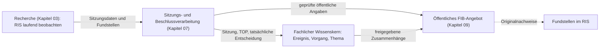

# 07 – Sitzungen und Beschlüsse (fachlicher Lese- und Migrationsentwurf)

**Stand:** 26.10.2026 · **Status:** Entwurf für die Durchsicht; die bestehende Primärquelle `docs/Sitzungs-und-Beschlussmodell.md` bleibt bis zur Regelmigration verbindlich.

## 07.1 Aufgabe und Abgrenzung

FIB soll politische Beratungs- und Entscheidungsabläufe im Gemeinderat nachvollziehbar machen: **Was wird beraten, was ist vorgeschlagen, was ist tatsächlich geschehen und beschlossen worden – und was bedeutet das für einen Vorgang oder ein Thema?**

Das Ratsinformationssystem (RIS) ist dafür eine maßgebliche **externe Quelle**. Die laufende Beobachtung neuer und geänderter RIS-Informationen ist Teil der **allgemeinen Recherche** (Kapitel 03), keine zweite unabhängige Recherche. Dieses Kapitel behandelt dagegen die **eigene fachliche Verarbeitung** des kommunalen Verfahrens. Die öffentliche Darstellung erfolgt über Kapitel 09.

**Aufgabenteilung auf einen Blick:**

## 07.2 Welche RIS-Informationen wohin gehören

FIB unterscheidet zwei **ergänzende Sichtweisen auf dieselben RIS-Inhalte**:

| RIS-Inhalt | Fachliche Rolle in FIB |
|---|---|
| Sitzungstermin, Gremium, Sitzungskennung | Strukturierte **Sitzung** |
| Tagesordnung, TOP-Nummer und Beratungsgegenstand | Strukturierter **TOP**; Hinweis, was vorgesehen ist |
| Beschlussvorlage und Anlagen | **Fundstellen** für Vorschlag, Sachverhalt und Begründung |
| Veröffentlichte Niederschrift | **Fundstelle** für tatsächlichen Sitzungsverlauf, Beschlussfassung und Abstimmung |
| Tatsächlich beschlossener Text | **Beschlusspunkt/Fassung**, durch Niederschrift oder andere geeignete Quellen belegt |
| Abstimmungsergebnis | **Abstimmung**, mit beschlossener Fassung und Nachweis verknüpft |

Die Sitzung und ihre TOPs sind eigenständige fachliche Objekte. **Eine Vorlage ist eine Fundstelle, nicht bereits der Beschluss.** Eine Niederschrift kann als Beleg für mehrere Beschlusspunkte dienen. Die bloße öffentliche Abrufbarkeit einer PDF rechtfertigt nicht automatisch ihre erneute öffentliche Bereitstellung durch FIB.

## 07.3 Fachlicher Ablauf

### 1. Sitzung und Tagesordnung erkennen

Die Recherche erkennt eine Sitzung, ihren Termin, das Gremium und die zugehörigen TOPs. Das Sitzungsmodell erfasst bzw. aktualisiert diese Informationen. Die Agenda kündigt einen Gegenstand an, beweist aber nicht dessen spätere Behandlung oder Beschlussfassung. Ein bereits bekannter Vorgang kann so frühzeitig eine anstehende Befassung erhalten.

### 2. Vorlagen und Anlagen erschließen

FIB verknüpft die Beschlussvorlage als Fundstelle mit dem passenden TOP. Aus ihr erschließt FIB den **Vorschlag**, einschließlich möglicher Entscheidungsalternativen und Begründungen. Die Veröffentlichung einer Vorlage kann ein eigenes Ereignis sein und damit einen Vorgang fortschreiben oder eine Meldung anregen. Es entsteht daraus noch **kein tatsächlich gefasster Beschluss**.

### 3. Beratung und tatsächliche Entscheidung nachvollziehen

Wenn belastbare Informationen über die stattgefundene Sitzung vorliegen, erfasst FIB die tatsächlichen Verfahrensschritte. Aus einer Niederschrift oder einem anderen geeigneten Nachweis werden insbesondere die wirklich zur Abstimmung gestellten Beschlusspunkte, ihre Fassungen und zugehörigen Abstimmungsergebnisse erschlossen. **Vorlage und Beschlussfassung sind getrennte Entwicklungen**; Ausfälle, Vertagungen und Absetzungen dürfen nicht als Annahme des Vorschlags erscheinen.

### 4. Vorlage mit Beschluss vergleichen

FIB stellt gegenüber, was ursprünglich vorgeschlagen und was später tatsächlich beschlossen wurde. Falls ein Beschluss verändert, in Teilen oder anders strukturiert angenommen wurde, muss diese Abweichung nachvollziehbar bleiben. Eine starre 1:1-Abbildung einzelner Vorlagenabsätze auf Beschlusspunkte wird nicht vorausgesetzt.

### 5. Wirkungen auf Ereignisse, Vorgänge und Themen prüfen

Behandlungen und Beschlüsse stehen über **Ereignisse** mit Vorgängen und Themen in Beziehung. Eine neue Entscheidung kann eine bestehende Vorgangsanalyse verändern oder einen Themenbeitrag aktualisierungsbedürftig machen. Diese Prüfung nutzt das allgemeine Änderungspaket- und Freigabemodell; Kapitel 07 erzeugt keine unabhängige zweite Redaktion.

### 6. Informationen für das öffentliche FIB-Angebot bereitstellen

Öffentliche Sitzungsansichten erschließen Sitzung, TOP, relevante Beschlussfassung und Abstimmungsergebnis sowie Links zum ursprünglichen Vorschlag und den zugehörigen Vorgängen/Themen. Ob zusätzlich eine Meldung sinnvoll ist, entscheidet der allgemeine Meldungsprozess; nicht jeder TOP erzeugt automatisch eine Meldung.

### Fachlicher Detailablauf: Vom Vorschlag zum nachgewiesenen Beschluss

Eine Beschlussvorlage beschreibt zunächst die **beabsichtigte Entscheidung**. FIB behandelt sie als Fundstelle und – sofern relevant – ihre Veröffentlichung als eigenes Ereignis. Die Zuordnung zu einer Sitzung und einem Tagesordnungspunkt macht aus dem Vorschlag noch keinen Beschluss.

| Zeitpunkt | Fachlicher Gegenstand | Was FIB festhalten darf |
|---|---|---|
| Vorlage erscheint | Dokument und Veröffentlichungsereignis | vorgeschlagene Maßnahme, Ausgangsfassung, Quellen- und Datumsnachweis |
| Tagesordnung wird veröffentlicht oder geändert | Sitzung und TOP | vorgesehene Behandlung, Tagesordnungsstand und Veränderung; kein fingiertes Abstimmungsergebnis |
| Sitzung findet statt | tatsächliche Beratung/Behandlung | nur mit geeigneten Belegen bestätigter Sitzungsverlauf; ohne Nachweis bleibt Ergebnis offen |
| Bekanntgabe oder Niederschrift | tatsächliche Beschlussfassung | beschlossener Wortlaut, Beschlusspunkte, Abstimmungen und Quelle nur soweit belegt |
| Berichtigung oder genehmigte Niederschrift | aktualisierter Nachweis | ursprüngliche Aussage, Änderung, Zeitpunkt und Herkunft bleiben nachvollziehbar |

**Mehrere Beschlusspunkte** eines TOPs können unterschiedliche Entscheidungen enthalten. Auch **mehrere Abstimmungen** zu einem Tagesordnungspunkt sind kein Widerspruch, sondern müssen der jeweils betroffenen Fassung oder dem jeweiligen Beschlusspunkt zugeordnet werden. Die ursprünglich vorgesehene Fassung darf dabei nicht durch den letztlich beschlossenen Wortlaut ersetzt werden.

**Niederschrift und Genehmigung:** Eine zunächst vorläufige Niederschrift ist als solcher Quellenstand kenntlich zu machen; ihre spätere Genehmigung oder Berichtigung ist eine weitere, nachvollziehbare Entwicklung. Wo geeignete amtliche Unterlagen noch fehlen, darf eine Pressequelle als gekennzeichneter Hinweis dienen, nicht als stillschweigend amtlich bestätigtes Ergebnis.

**Beispiel:** Beim Grundstückskauf der Gemeinde Feldkirchen enthält die Vorlage einen Beschlussvorschlag. Erst wenn ein geeigneter Nachweis zur Sitzung vorliegt, kann FIB berichten, ob und mit welcher Fassung darüber entschieden wurde. Änderungen des Kaufgegenstands oder der Bedingungen sind als Unterschied zwischen vorgeschlagenem und beschlossenem Stand zu beschreiben.

Diese Erläuterung konkretisiert das bisherige [Sitzungs- und Beschlussmodell](../Sitzungs-und-Beschlussmodell.md). Die dortigen differenzierten Detailregeln zu Status und Verfahrensereignissen bleiben bis zur vollständigen normativen Migration die maßgebliche Bestandsquelle.

## 07.4 Wichtige fachliche Sicherungen

- Bei unsicherer Zuordnung von Niederschrifteninhalten zu TOPs, Vorlagen oder Beschlusspunkten schlägt FIB eine **redaktionelle Prüfung** vor und übernimmt strittige Zuordnungen nicht stillschweigend.
- **Genehmigung einer Niederschrift** und **öffentliche Verfügbarkeit ihres Dokuments** sind verschiedene Sachverhalte. Eine Sitzung kann fachlich abgeschlossen sein, obwohl eine genehmigte Niederschrift nicht öffentlich als PDF vorliegt.
- Frühere Fassungen und Belege werden nachvollziehbar erhalten. Ein späterer amtlicher Nachweis kann eine frühere Presseinformation bestätigen, ergänzen oder berichtigen.
- Beziehungen **Meldung → Ereignis → TOP/Sitzung** werden abgeleitet, nicht als zweite unabhängige Meldungs-TOP-Zuordnung erfasst.
- Jede öffentliche Datei- oder Bildbereitstellung unterliegt zusätzlich den allgemeinen Rechte- und Freigaberegeln.

## 07.5 Abnahmeszenarien

1. RIS veröffentlicht TOP mit Vorlage: FIB zeigt den vorgesehenen Beratungspunkt, **noch keinen Beschluss**.
2. Sitzung behandelt TOP nicht: keine falsche Beschlussmeldung.
3. Niederschrift enthält vom Vorschlag abweichende beschlossene Fassung: FIB zeigt Originalvorschlag, beschlossene Fassung und Abstimmung getrennt.
4. Niederschrift ist noch nicht verfügbar: FIB kennzeichnet Unsicherheit bzw. den vorläufigen Informationsstand, ohne die tatsächliche Entscheidung zu erfinden.
5. Ein TOP betrifft Parkraumkonzept und Mobilitätsthema: FIB verknüpft die Information über das Ereignis mit Vorgang und Thema.
6. Späterer RIS-Nachweis korrigiert einen früheren Pressebericht: Änderungsvorschlag mit prüfbaren Belegen und ggf. Korrekturaufgabe für öffentliche Inhalte.

## 07.6 Übergabe und offene Migration

- **Kapitel 03:** Wann und wie RIS beobachtet wird; Fundstellen- und Änderungserkennung, Quellenlücken und Rechercheausführung.
- **Kapitel 07 (hier):** Sitzungs-, TOP-, Vorlagen-, Niederschriften-, Beschlusspunkt- und Abstimmungslogik.
- **Kapitel 04/05/06:** Ereignisse, Vorgänge und Themen als fachliche Folgewirkungen.
- **Kapitel 08/10:** Redaktionelle Entscheidungen, Rechte und Qualitätssicherung.
- **Kapitel 09:** Öffentliche Sitzungsnavigation und Darstellungsregeln.

**Noch nicht vollständig migriert:** die verbindlichen Detailregeln zu TOP-Verfahrensstatus, Beschlusspunkt-Fassungen, mehrfachen Abstimmungen, Niederschriftgenehmigung und deren Herkunft/Versionierung aus `docs/Sitzungs-und-Beschlussmodell.md`. Sie dürfen durch diesen Leseentwurf nicht verloren gehen. Die technische RIS-Anbindung (Abfragefrequenz, Änderungsabgleich, Fehlerbehandlung und Aktualitätsnachweis) benötigt später einen eigenen Implementierungsabgleich.
