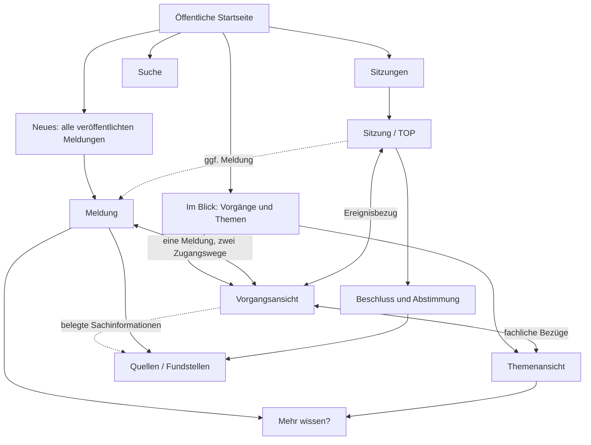

# 09 – Öffentliches FIB-Angebot (Lese- und Migrationsentwurf)

**Stand:** 26.10.2026 · **Status:** Fachlicher Entwurf zur Durchsicht, keine technische UI-Freigabe. Die bestehenden Fachquellen – insbesondere `docs/UX-und-Informationsarchitektur.md` und `docs/Mehr-wissen-Modell.md` – bleiben bis zum vollständigen Regelabgleich verbindlich.

## 09.1 Aufgabe und Nutzen für Besucher

Das öffentliche FIB-Angebot soll Menschen in Feldkirchen helfen, **neue Entwicklungen zu entdecken, den aktuellen Sachstand zu verstehen, bisherige Entscheidungen nachzuvollziehen und größere Zusammenhänge zu erkennen**. Es ist das Ergebnis des gesamten Systems, nicht bloß eine Ausgabe der Meldungsdatenbank.

Die fachlichen Zugänge beantworten unterschiedliche Fragen:

| Zugang | Besucherfrage | Fachliche Grundlage |
|---|---|---|
| **Meldung** | Was ist neu passiert? | freigegebener Bericht über genau ein Ereignis |
| **Vorgang** | Wie hat sich ein konkreter Sachverhalt entwickelt und wo steht er? | Ereignisse, Meldungen und geprüfte Vorgangsanalyse |
| **Thema** | Welche übergreifende Frage verbindet verschiedene Entwicklungen? | Themenanalyse, Vorgänge, weitere Ereignisse und freigegebener Themenbeitrag |
| **Sitzung** | Was steht zur Beratung an, was wurde tatsächlich entschieden? | Sitzung, TOP, Vorlagen und belegte Beschlüsse/Abstimmungen |
| **Mehr wissen?** | Welche Hintergründe und Folgen lassen sich genauer erklären? | freigegebene quellengebundene Vertiefungsantwort |

**Grundsatz:** FIB soll primär den **aktuellen Wissensstand und seine Entwicklung** erschließen, nicht eine bloße Folge isolierter Dokumente oder Nachrichten liefern. Keine interne Analyse wird allein dadurch öffentlich, dass sie im Redaktionssystem vorhanden ist.

## 09.2 Wie die öffentlichen Informationen zusammenhängen

Das Diagramm stellt **Navigationswege** dar, keine zusätzlichen Datenbankbeziehungen. Ein öffentlich sichtbarer Zusammenhang wird aus den geprüften Fachbeziehungen abgeleitet und erzeugt keine zweite unabhängige Meldung oder ein dupliziertes Ereignis.

## 09.3 Aktuelles entdecken: Meldungen und Vorgänge

Eine Meldung informiert über ein berichtenswertes Ereignis. Die öffentliche Meldungsliste enthält **alle veröffentlichten Meldungen**, nicht nur isolierte oder jüngste Meldungen. Das umfasst ausdrücklich auch Meldungen, deren Ereignisse zu einem Vorgang gehören.

**Fachlich entschieden am 26.10.2026:** Eine solche Meldung wird **sowohl in der aktuellen Übersicht als auch im Verlauf des betreffenden Vorgangs** angezeigt. Es bleibt **dieselbe Meldung mit zwei Zugangswegen**; ihre Zuordnung wird aus Meldung → Ereignis → Vorgang hergeleitet. Mehrere Meldungen desselben Vorgangs dürfen für eine übersichtliche Darstellung zusammengefasst werden, ohne Auffindbarkeit oder eigenständige Links einzubüßen.

Die Liste bietet Titel, prägnante Zusammenfassung, Ursprungsdatum, bei relevanter Änderung das Aktualisierungsdatum und gegebenenfalls den Vorgangs-/Themenkontext. Maßgeblich für ihre Sortierung ist **die letzte fachlich relevante Entwicklung**, nicht eine rein technische Bearbeitung. Interne Relevanzwerte werden nicht als Zahlen gezeigt.

**Aktualisieren oder neue Meldung?** Neue gesicherte Informationen zum *selben* Ereignis können die bestehende Meldung in einer neuen freigegebenen Fassung aktualisieren. Ein *neues* eigenständiges Ereignis mit ausreichendem Nachrichtenwert kann eine weitere Meldung begründen. Bei Folgemeldungen helfen Verknüpfungen und ein kurzer Rückblick, den bisherigen Verlauf zu verstehen. Öffentliche Fassungen werden niemals unbemerkt überschrieben.

## 09.4 Konkrete Sachverhalte verfolgen: Vorgangsansicht

Ein Vorgang verbindet mehrere Ereignisse desselben längerfristigen Sachverhalts, etwa das Parkraumkonzept. Besucher sollen hier erkennen:
1. **Worum geht es?** Der Gegenstand und seine Abgrenzung.
2. **Wo stehen wir?** Der derzeit belastbare Sachstand und seine zeitliche Einordnung.
3. **Was ist bisher passiert?** Eine nachvollziehbare Folge wesentlicher Ereignisse und ihrer öffentlichen Meldungen.
4. **Welche Fragen sind noch offen?** Sachlich relevante Unsicherheiten ohne vorgetäuschte Gewissheit.
5. **Welche Zusammenhänge bestehen?** Verbindungen zu Sitzungen, Beschlüssen, Quellen und Themen.

Die **Vorgangsanalyse** bildet die fachliche Grundlage für die öffentliche Darstellung, ist aber **nicht selbst automatisch öffentlich**. Es werden nur die dafür geprüften und entsprechend freigegebenen Informationen verwendet.

Die Detailfrage, ob FIB über die zeitliche Meldungsübersicht hinaus einen eigenständig freizugebenden öffentlichen **Vorgangstext/Sachstandsbericht** benötigt, ist **noch nicht abschließend entschieden**. Die öffentliche Vorgangsansicht als Orientierung und Navigationszugang ist dagegen eine bereits dokumentierte Zielanforderung.

## 09.5 Größere Zusammenhänge verstehen: Themenansicht

Ein Thema erschließt eine übergreifende Fragestellung und verknüpft relevante Vorgänge sowie gegebenenfalls weitere einzelne Ereignisse. Öffentlich steht der **freigegebene Themenbeitrag** im Mittelpunkt; seine Grundlage ist die geprüfte Themenanalyse.

Die Seite führt nachvollziehbar zu verbundenen Vorgängen, wichtigen Entwicklungen und Quellen. Die optionale **„Unsere Einordnung“** ist sprachlich und sachlich von überprüfbaren Tatsachen zu trennen. Eine Themenanalyse darf eigenständige übergreifende Erkenntnisse enthalten, aber daraus entsteht keine automatische Veröffentlichung.

Die öffentliche Liste **„Im Blick“** führt **Vorgänge und Themen gemeinsam**. Die redaktionsinterne Trennung bleibt bestehen, wird Besuchern aber nur so deutlich angezeigt, wie sie das Verständnis fördert. Vorgänge können auch ohne übergeordnetes Thema eigenständig erscheinen.

## 09.6 Sitzungen und Beschlüsse nachvollziehen

Eine Sitzung ist ein eigener öffentlicher Informationszugang, unabhängig davon, ob aus ihren TOPs Meldungen entstehen. Die Übersicht soll anstehende Sitzungen und zurückliegende Beratungen auffindbar machen.

Die Sitzungs- und TOP-Ansicht unterscheidet:
- **Angekündigt:** Tagesordnung, zugeordnete Vorlage, Unterlagen, soweit vorhanden.
- **Behandelt:** tatsächlich erfolgte Beratung, Vertagung/Absetzung oder Beschlussfassung.
- **Beschlossen:** belegte Beschlusspunkte, ihre tatsächlich abgestimmten Fassungen und Abstimmungsergebnisse.
- **Nachweis:** Verweis auf ursprünglichen Beschlussvorschlag und verfügbare Niederschrift, unter Beachtung der Nutzungs- und Bereitstellungsrechte.

Ein TOP auf der Agenda ist **kein Beweis für eine spätere Beschlussfassung**. Beschlossener Text und ursprünglicher Vorschlag können voneinander abweichen. Die Fachlogik dieser Unterschiede gehört in **Kapitel 07**, die Gestaltung und Navigation hierher.

Über das zugrunde liegende Ereignis sind Verweise zwischen Sitzung/TOP und Vorgang/Thema in beide Richtungen möglich. Eine Meldung wird nicht unabhängig ein weiteres Mal mit dem TOP verknüpft.

## 09.7 Hintergründe erschließen: „Mehr wissen?“

Eine Meldung oder ein Thema kann mehrere öffentlich angebotene **Vertiefungsfragen** mit redaktionell freigegebenen Antworten besitzen. Die Fragen erschließen unter anderem fachliche Hintergründe, Rechtsrahmen, Folgen, Zielkonflikte, Vergleichsfälle oder die mögliche künftige Bedeutung einer Entwicklung.

**Wichtig:** Eine öffentlich angebotene Vertiefungsfrage ist nicht mit einer **internen offenen Wissensfrage** der Redaktion zu verwechseln. Die Antworten müssen quellengebunden, hinsichtlich Unsicherheit ehrlich und auf ihren fachlichen Stand prüfbar sein. Für den bisherigen MVP-Grundsatz werden öffentlich grundsätzlich nur Fragen mit freigegebener Antwort angeboten.

Das bestehende `docs/Mehr-wissen-Modell.md` sieht als primären Kontext **Meldung oder Thema** vor. Da Vorgänge nun ein wesentlicher öffentlicher Zugang sind, ist fachlich zu prüfen, ob und wie Vorgänge ebenfalls eigene Vertiefungsfragen erhalten sollen. **Hier wird noch keine neue Kardinalität beschlossen.**

## 09.8 Orientierung, Einstiege und Suche

Bisher vereinbarte öffentliche Hauptnavigation:
- **Neues:** veröffentlichte Meldungen.
- **Im Blick:** gemeinsame Liste aus Vorgängen und Themen.
- **Sitzungen:** anstehende und vergangene Sitzungen.
- **Suche:** struktur- und textbasierte Suche.

Die Startseite orientiert in drei Bereichen: **Neue Entwicklungen**, **Anstehende Sitzungen** und **Im Blick**. Die Kennzeichnung **„Neu seit letztem Besuch“** wird innerhalb dieser Bereiche verwendet, nicht als selbstständiger vierter Block.

Es gilt: **Startseite = Orientierung; Liste = Überblick; Detailseite = Verständnis.**

Jede öffentliche Meldung, jeder Vorgang, jedes Thema und jede Sitzung soll einen **eigenständigen, stabilen Link** besitzen. Der Einstieg darf auch über Suchmaschinen, geteilte Links, QR-Codes oder die installierte PWA erfolgen. Die zentrale Suche soll Bezeichnungen, Sachbezüge und hinterlegte alternative Benennungen nutzen, damit beispielsweise ein Straßen- oder Infrastrukturprojekt unter mehreren geläufigen Namen gefunden wird.

Darstellungsdetails wie Iconformen, Bannerproportionen und konkrete Filter gehören zur nachfolgenden UI-Erprobung. Die bereits verbindlichen UX-Details aus dem bisherigen `docs/UX-und-Informationsarchitektur.md` bleiben bis zur Migration erhalten.

## 09.9 Vertrauen, Transparenz und Aktualität

Ein öffentlicher Beitrag lässt erkennen, **was gesichert ist, was offen bleibt und auf welche Quellen er sich stützt**. Relevante Änderungen werden als solche erkennbar; rein technische Bearbeitungen lösen keine Scheinaktualität aus. Wesentliche Korrekturen müssen erklären, was geändert wurde und warum.

Die öffentliche politische Einordnung wird als solche gekennzeichnet und nicht mit der Tatsachenebene vermischt. Fachbegriffe werden bürgernah erläutert, ohne ihre sachliche Bedeutung zu verändern. Quellen können extern verlinkt werden; eine lokale Kopie oder öffentliche Bereitstellung von Dokumenten benötigt die vorgesehenen Rechteprüfungen.

FIB kann verpasste Entwicklungen durch **„Neu seit letztem Besuch“**, PWA-Funktionen und spätere Benachrichtigungskanäle erschließen. Anforderungen zur konkreten Benachrichtigungsfrequenz und Browser-/Geräteunterstützung sind vor technischer Umsetzung gesondert abzunehmen.

## 09.10 Öffentliche Ausgabe folgt redaktioneller Freigabe

Keine vorläufige KI-Erkenntnis, keine interne Analyse und kein neu erfasstes Ereignis wird allein aufgrund seiner Existenz öffentlich. Die relevanten Informationen benötigen die im Redaktionsteil festgelegten Prüfungen, Freigaben und Veröffentlichungsentscheidungen.

Bei späterem Erkenntnisgewinn prüft FIB die Aktualität der öffentlichen Inhalte, erstellt nötigenfalls einen Änderungsvorschlag und priorisiert belegte schwerwiegende Korrekturen. Die Redaktion entscheidet über neue Fassungen. Der genaue Workflow gehört in **Kapitel 08**, die Qualitätskriterien in **Kapitel 10**.

## 09.11 Fachliche Abnahmeszenarien

1. Eine neue Meldung zum Parkraumkonzept erscheint unter **„Neues“** und zugleich im Verlauf des Vorgangs; keine zweite Meldung wird gespeichert.
2. Ein Besucher folgt einem direkten Link zu einer Meldung und findet den übergeordneten Vorgang ohne Umweg über die Startseite.
3. Ein Vorgang ohne Thema erscheint in **„Im Blick“**.
4. Ein Thema erklärt einen übergreifenden Zusammenhang und verbindet mehrere Vorgänge, ohne ihre Ereignisse doppelt zu zählen.
5. Vor einer Ratssitzung wird der TOP mitsamt Vorlage angezeigt, ausdrücklich **ohne** bereits behaupteten Beschluss.
6. Nach Erscheinen der Niederschrift erkennt der Besucher tatsächliche Beschlussfassung, Abstimmung und mögliche Abweichung vom Vorschlag.
7. Eine Vertiefungsfrage erscheint öffentlich nur mit dafür freigegebener Antwort; deren Aussagen sind belegbar.
8. Eine technisch bearbeitete Meldung wird nicht als neue inhaltliche Entwicklung angezeigt.
9. Eine öffentliche Korrektur verändert nicht stillschweigend die früher veröffentlichte Fassung.

## 09.12 Noch zu klärende Punkte und Regelmigration

**Fachliche Fragen für die Durchsicht:** Umfang einer eigenständig freigegebenen Vorgangs-Sachstandsdarstellung; eigene „Mehr wissen?“-Fragen für Vorgänge; Gewichtung und Bündelung von Meldungen desselben Vorgangs in öffentlichen Listen; Detailtiefe und Links von Sitzungsansichten.

**Regelmigration:** Bisherige verbindliche Detailanforderungen aus `docs/UX-und-Informationsarchitektur.md`, `docs/Mehr-wissen-Modell.md`, `docs/Sitzungs-und-Beschlussmodell.md`, `docs/Sprachleitfaden.md` und den Beitrags-/Freigaberegeln werden noch abschnittsweise zugeordnet. Dieser Leseentwurf schafft **keine** konkurrierende neue Norm und ersetzt weder Rechteprüfung noch Veröffentlichungsgenehmigungen.

**Schnittstellen:** Kapitel 02 Struktur, 04 Meldungen, 05 Vorgänge, 06 Themen, 07 Sitzungen, 08 Redaktion, 10 Qualität, 11 Rechte.
