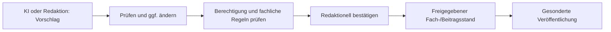

# 11 – Fachliche Rollen, Rechte und Verantwortung (Leseentwurf)

**Stand:** 26.10.2026 · **Status:** Migrationsentwurf. `docs/Rollen-Rechte-und-Workflow.md` bleibt bis zur vollständigen Regelübernahme verbindlich. Technische Authentifizierung und konkrete RLS-Policies werden hier nicht neu spezifiziert.

## 11.1 Wozu braucht FIB Rollen und Rechte?

FIB trennt **öffentliche Information**, **redaktionelle Arbeit**, **fachlich verbindliche Entscheidungen** und **Administration**. Ein berechtigter Mensch soll wirksam arbeiten können, während unbeabsichtigte Veröffentlichung, Verlust bestätigter Inhalte und unzulässige Zugriffe verhindert werden.

Dabei bestimmt nicht ein sichtbarer Button allein eine Berechtigung. Maßgeblich ist die Kombination aus **Rolle, Fachaktion, Objektzustand, Schutzklasse, Aktionsstufe und notwendiger Bestätigung**.

## 11.2 Wer arbeitet mit FIB?

| Akteur | Zuständigkeit | Fachliche Grenze |
|---|---|---|
| **Besucher** | freigegebene öffentliche Inhalte lesen und durchsuchen | keine redaktionelle oder administrative Änderung |
| **Redakteur** | recherchieren, analysieren, fachlich entscheiden, Beiträge freigeben und veröffentlichen | keine systemweit administrativen Sonderrechte |
| **Administrator** | sämtliche regulären Redaktionsaufgaben sowie Benutzer-/Rollenverwaltung und geschützte Systemeinstellungen | besondere Eingriffe müssen begründet und nachvollziehbar bleiben |
| **KI-/AI-Task** | bereitgestellte Quellen analysieren, vorläufige Daten/Entwürfe vorbereiten und begründete Vorschläge liefern | keine eigenständige redaktionelle Freigabe oder Veröffentlichung |

**Keine eigenständige Publisher-Rolle:** Ein Redakteur darf Inhalte im vorgesehenen Verfahren selbst freigeben und veröffentlichen. Selbstfreigabe ist grundsätzlich zulässig. Die KI ist **keine menschliche Rolle**.

## 11.3 Welche Arten von Handlungen unterscheidet FIB?

Das bestehende Konzept trennt Aktionsstufen:

| Stufe | Sinn | Beispiel |
|---|---|---|
| **S0 – Lesen/Analysieren** | vorhandene zulässige Informationen auswerten | Vorgangsanalyse anzeigen, Rechercheergebnis lesen |
| **S1 – Vorschlag/Entwurf** | noch nicht verbindliche Vorarbeit | Meldungstext vorschlagen, Themenkandidaten erkennen |
| **S2 – Fachlich wirksam ändern** | bestätigten internen Sachstand ändern | Ereignis bestätigen, Themenbezug redaktionell festlegen |
| **S3 – Öffentlich/normativ wirksam** | besonders geschützte Freigabe, Veröffentlichung oder normative Änderung | Beitrag veröffentlichen, Datei öffentlich bereitstellen, geschützten Referenzmaßstab aktivieren |

Eine normale Rechercheausführung darf nicht durch ihre technische Ausführung zur öffentlichen Freigabe werden. **Eine allgemeine Freigabe für die eigenständige Ausführung eines klar begrenzten Rechercheauftrags** ist von einer Freigabe späterer Erkenntnisse zu unterscheiden.

## 11.4 Wie entsteht eine redaktionell verbindliche Entscheidung?

Die Arbeitsfolge variiert je nach Gegenstand. Für **Analysen** ist eine fachliche **Teilfreigabe** möglich (F-03: neuer bestätigter Gesamtstand nur mit angenommenen Änderungen; offene Vorschläge bleiben getrennt). Bei **Beiträgen** wird eine bestimmte Fassung freigegeben; Veröffentlichung ist eine eigenständige Handlung, sofort oder später terminiert. Eine freigegebene Vorgangsanalyse ersetzt nicht die Beitragsfreigabe des **Vorgangsbeitrags**. Entsprechendes gilt für Themenanalysen und Themenbeiträge.

Die Analysefreigabe verändert den **Themenstatus** nicht; der Wechsel von Entwurf zu Aktiv erfolgt nach der bestehenden Regel bei der **ersten Beitragsfreigabe**.

### Fachliche Entscheidungsmatrix für den Redaktionsalltag

Die Aktionsstufen ersetzen die **konkrete Handlung** nicht. Insbesondere die vorbereitende KI-Arbeit darf nicht als stillschweigende Freigabe einer späteren Entscheidung behandelt werden.

| Handlung | KI | Redakteur | Administrator | Besondere Grenze |
|---|---|---|---|---|
| Quellen recherchieren, Fundstellen erfassen, vorläufige Ereignisse vorbereiten | selbstständig im zulässigen Rahmen | ja | ja | keine endgültige fachliche Bestätigung allein durch KI |
| Bestehenden, bestätigten Ereignisinhalt sachlich ändern | Änderungsvorschlag | verbindliche Entscheidung | verbindliche Entscheidung | Belege und Audit; kein verdecktes Überschreiben |
| Vorgangs- oder Themenanalyse ergänzen | vorläufige Vorschläge und Teilfragen | fachlich prüfen, bestätigen oder zurückstellen | ebenfalls | Bestätigtes vor KI-Überschreibung schützen |
| Thema neu und verbindlich anlegen | Kandidat vorschlagen | ja | ja | Dublettenprüfung und klare Leitfrage |
| Themenbezug und Bedeutung für das Thema verbindlich festlegen | Kandidat/Einstufung vorschlagen | ja | ja | negativ bestätigte Entscheidung nicht automatisch aufheben |
| Analyse (teilweise) freigeben | nein | ja | ja | keine öffentliche Beitragsfreigabe, kein Thema-Statuswechsel |
| Meldung, Vorgangs- oder Themenbeitrag freigeben | nein | ja, auch eigene Fassung | ja | freigegebene konkrete Fassung fixieren |
| Freigegebenen Beitrag veröffentlichen oder zurückziehen | nein | ja | ja | eigener ausdrücklicher S3-Schritt, aktueller Zustand erneut prüfen |
| Redaktionelle Federführung übernehmen | nein | gemäß Koordination | gemäß Koordination | keine exklusiven Fachrechte durch Federführung |
| Bestehende fremde Bearbeitungssperre außerordentlich lösen | nein | kein generelles Sonderrecht | nur nach begründeter Schutzprüfung | Audit, keine unbemerkte parallele Bearbeitung |
| FIB-Benutzer und Rollen verwalten | nein | nein | ja | separate geschützte Administration |

**Grenzfall:** Ein Redakteur hat eine Themenanalyse selbst erstellt. Er darf diese fachlich prüfen und im vorgesehenen Verfahren freigeben; ein vorgeschriebener zweiter Prüfer ist nicht nötig. Das macht aber weder die darin enthaltenen KI-Vorschläge automatisch zu gesicherten Tatsachen noch veröffentlicht es den Themenbeitrag. Die erste **Beitragsfreigabe** aktiviert das Thema, die anschließende Veröffentlichung benötigt eine eigene bestätigte Aktion.

Diese Matrix erläutert die fachliche Verantwortung. Konkrete Authentifizierung, serverseitige Rollenprüfung, RLS-Policies und Sperrtransaktionen bleiben nachgelagerte technische Verträge; sie dürfen die hier beschriebenen Rechte **nicht** stillschweigend erweitern.

## 11.5 Wann muss ausdrücklich bestätigt werden?

Bei risikoarmen eindeutigen S2-Einzeländerungen kann die klare Handlungsanweisung eines berechtigten Redakteurs genügen. Bei mehrdeutigen, folgenreichen oder mehrere Objekte betreffenden Änderungen ist eine erkennbare Vorher-/Nachher-Prüfung und ausdrückliche Bestätigung erforderlich.

Für **S3** gilt weiterhin eine ausdrückliche Bestätigung. Die bisherige Rechtequelle verlangt sie grundsätzlich unmittelbar vor Ausführung; für **terminierte Veröffentlichungen** gilt die nachfolgend beschlossene, eng begrenzte fassungs- und termingebundene Ausnahme. Dazu gehören insbesondere Veröffentlichung und Rücknahme, die erstmalige öffentliche Bereitstellung interner Dokumente sowie die erste öffentliche Verwendung eines Bildes. Vor Ausführung werden Rechte, Objektzustand, Version und Schutzbedingungen serverseitig erneut geprüft.

**Beschlossene Ausnahme für terminierte Veröffentlichung:** Eine berechtigte Person bestätigt bei der Terminierung als S3-Handlung ausdrücklich **eine bestimmte freigegebene Fassung und einen bestimmten Veröffentlichungstermin**. Die automatische Ausführung zu diesem Termin verlangt keine zweite manuelle Bestätigung. FIB prüft unmittelbar vor Ausführung Berechtigung, gültige Freigabe, Fassungsidentität, Termin und sonstige Voraussetzungen erneut. Bei negativen Prüfergebnissen bleibt die Veröffentlichung aus und die Redaktion erhält eine Aufgabe. Änderungen an Fassung oder Termin verlangen eine erneute gebundene Bestätigung. Andere S3-Aktionen bleiben bei der bisherigen unmittelbaren Bestätigung.

## 11.6 Welche Freiheiten hat die KI bei vorläufigen Daten?

**Fachlich neu bestätigt:** FIB darf vorläufige Ereignisse selbstständig erfassen, zuordnen und fachlich weiterverarbeiten, ohne für jedes Ereignis eine Pflicht zur redaktionellen Einzelbestätigung auszulösen. Alle Quellen und Ereignisse bleiben sichtbar; wesentliche Unsicherheit oder fachliche Konflikte lösen gezielte Prüfaufgaben aus.

Die Bestandsmatrix erlaubt AI-Tasks im Grundsatz **S0/S1**, ohne bestätigende S2-/S3-Aktionen. Deshalb muss die technische Modellierung ausdrücklich unterscheiden zwischen **reversibler vorläufiger Anlage** und **verbindlicher fachlicher Bestätigung**. Diese neue Fachanforderung bedeutet **keine pauschale Befugniserweiterung der KI**.

## 11.7 Wie werden parallele Bearbeitungen koordiniert?

Eine **Federführung** organisiert Verantwortung, ist aber kein exklusives Bearbeitungsrecht. Bearbeitungssperren verhindern konkurrierendes Schreiben; andere berechtigte Redakteure können dann lesen und ggf. eine Übernahme anfragen. Eine Übernahmeanfrage verleiht keine zusätzlichen Rechte.

Admins dürfen verwaiste fremde Sperren unter Auditbedingungen aufheben. Fachlich wirksame Änderungen müssen veraltete Objektstände erkennen und dürfen keinen neueren bestätigten Stand stillschweigend überschreiben.

Eine gemeinsame Aufgabenübersicht zeigt offene **menschliche Entscheidungen**, nicht jede technische KI-Aktivität. Berechtigte Personen können Aufgaben übernehmen; organisatorische Zuweisungen und Priorisierung verändern die fachlichen Grundrechte nicht.

## 11.8 Was darf nur ein Administrator?

Insbesondere:
- FIB-Benutzer anlegen, deaktivieren sowie Rollen erteilen oder entziehen;
- sicherheitsrelevante Konfiguration, Providerzugänge und Secrets verändern;
- besonders geschützte normative Regeln und Referenzmaßstäbe aktivieren;
- systemweite KI-Routing- und Sicherheitsgrenzen ändern;
- besonders geschützte technische Betriebs- oder Ausnahmeaktionen ausführen.

Der reguläre redaktionelle Arbeitsprozess einschließlich Freigabe und Veröffentlichung braucht **keinen Administrator**.

## 11.9 Zugangsschutz und Audit

FIB verwendet keine öffentliche Selbstregistrierung für die Redaktion. Für Redakteure und Administratoren ist **MFA/TOTP verpflichtend**. Normale redaktionelle Arbeit erfordert nicht vor jeder Veröffentlichung einen neuen Authenticator-Code. Kritische administrative Eingriffe können dagegen eine erneute starke Authentifizierung (Step-up) erfordern.

Rollenentzug und Deaktivierung müssen serverseitig wirksam sein – auch wenn ein Browser noch eine Sitzung gespeichert hat. Die eigentliche Entscheidung über Fachrechte liegt in den **Fachservices**; RLS und Datenbankregeln bilden zusätzliche Schutzschichten. Für fachlich wirksame oder besonders geschützte Aktionen werden Akteur, Zeitpunkt, betroffene Objekte, relevante Änderungen, Berechtigungsprüfung und Bestätigung nachvollziehbar auditiert.

### Benutzerlebenszyklus und laufende Sitzungen

FIB bietet **keine öffentliche Selbstregistrierung**. Ein Administrator richtet interne Benutzer ein und legt die FIB-Rolle fest; die eingeladene Person schließt ihre Passwort- und MFA-Einrichtung selbst ab. Erst ein aktiver Anwendungszugang mit erfüllten Sicherheitsanforderungen berechtigt zur Arbeit.

Beim Austritt wird ein Benutzer im Regelfall **deaktiviert**. Eine endgültige Löschung ist nur möglich, wenn keine erforderlichen Fachreferenzen oder Auditnachweise verloren gehen; andernfalls bleibt die Deaktivierung maßgeblich.

**Entzug von Rechten wirkt serverseitig:** Eine noch geöffnete Browsersitzung darf entzogene Befugnisse nicht fortschreiben. Vor besonders wirksamen Freigabe- und Veröffentlichungsaktionen prüft FIB daher erneut den aktuellen Benutzer- und Rollenstatus.

**Koordination ist keine Berechtigung:** Federführung, letzte Bearbeitung, Sperren und Übernahmeanfragen zeigen Zuständigkeiten und verhindern Bearbeitungskonflikte; sie verleihen keine neuen Fachrechte. Eine Übernahmeanfrage ändert die Federführung nicht automatisch. Das Aufheben verwaister fremder Sperren durch Administratoren ist zu protokollieren.

Fachquelle: [Rollen, Rechte und Workflow](../Rollen-Rechte-und-Workflow.md), §§9–9.2.

## 11.10 Abnahmefälle

1. Redakteur verfasst, bestätigt und veröffentlicht eine Meldung, ohne Adminrolle.
2. KI erstellt ein vorläufiges Ereignis; redaktionell bestätigter Ereignisinhalt bleibt geschützt.
3. KI erkennt Widerspruch in einem bestätigten Vorgang; es entsteht ein begründeter Änderungsvorschlag, keine verdeckte Überschreibung.
4. Eine Analyse wird teilweise freigegeben; der noch offene Anteil bleibt sichtbar und ungeprüft.
5. Vorgangsbeitrag und Themenbeitrag werden als konkrete Fassung freigegeben; Veröffentlichung folgt gesondert.
6. Ein zweiter Redakteur sieht eine fremde aktive Bearbeitungssperre und kann nur lesen.
7. Deaktivierter Redakteur kann trotz bestehender Browsersitzung keine geschützte Änderung ausführen.
8. Eine erstmalige öffentliche Bild- oder Dateinutzung ohne positiv geklärte Rechte wird gesperrt.
9. Eine geplante Veröffentlichung wird vor ihrer Ausführung erneut auf Berechtigung und Gültigkeit geprüft.

## 11.11 Quellabgleich und offene Umsetzung

- **Vollständig zu übernehmen:** bestehende Fachfunktionsmatrix, S0–S3-Bestätigungslogik, Schutzklassen, Adminvorbehalte, serverseitige Revalidierung, Sperren, Audits und technische Zugangsgrenzen aus `docs/Rollen-Rechte-und-Workflow.md`.
- **Neu zu konkretisieren:** vorläufige KI-Ereigniserfassung innerhalb S1, Freigabe/Versionierung von Vorgangsbeiträgen, teilfreigegebene Analysen, zeitgesteuerte Veröffentlichung sowie Aufgabenübernahme und -zuweisung.
- **Fachkapitel:** Fachprozesse in 03–07; Entscheidungsabläufe in 08; öffentliche Darstellung in 09; Qualitätsblocker in 10.
- **Technische Sicherheit:** gesonderte Security-/ADR- und RLS-Dokumentation bleibt maßgeblich; dieses Kapitel ist keine Freigabe zur Änderung von Benutzerkonten oder Authentifizierung.

**Quellen:** `docs/Rollen-Rechte-und-Workflow.md`, `docs/Fachliche-Plausibilitaets-und-Freigaberegeln.md`, `docs/Datenmodell.md`, `docs/Redaktionsworkflow.md` und die Fachhandbuch-Migrationsentwürfe.
