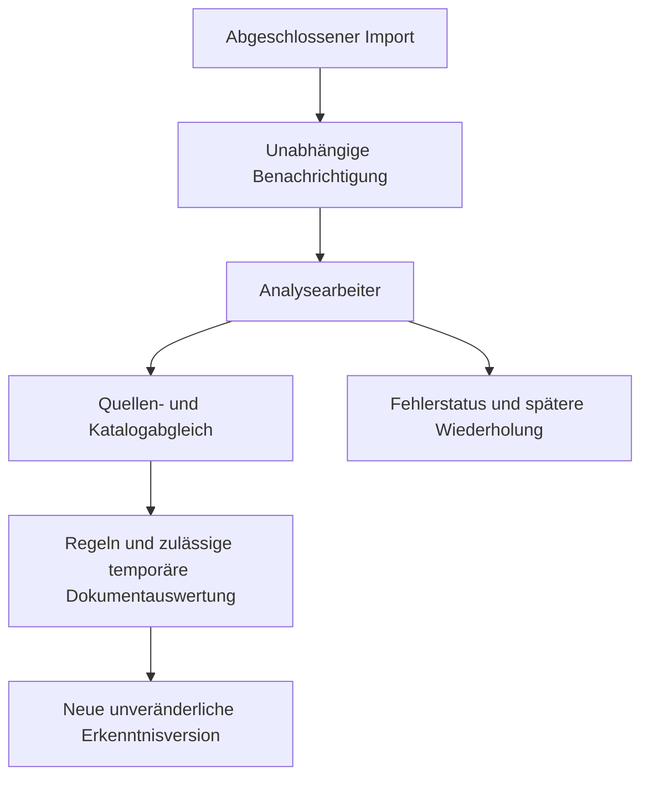

# Automatische RIS-Inhaltsanalyse – Paket B

**Stand 11.11.2026.** Umsetzung zu [#428](https://github.com/PustefixReisen/fib-echtsystem/issues/428) auf Grundlage der RIS-Fachabnahme und PR #429. Der Code implementiert eine getrennte regelbasierte Analyse. Die Installation und Aktivierung im Entwicklungsbetrieb ist ein eigener kontrollierter Schritt. Eine bestehende Analyseinstallation wurde beim lesenden Vorabgleich nicht vorgefunden.

## Fachlicher Umfang

Der Import bleibt für amtliche Sitzungs-/TOP-Daten, je TOP ein geschütztes Ereignis, automatische Dokumentfundstellen und belegte Abstimmungen zuständig. Die Analyse erzeugt eigenständige, automatisch gekennzeichnete Erkenntnisse. Sie verändert weder den Importbestand noch die Ereignisse oder deren Beziehungen. Die Ergebnisse besitzen keinen redaktionellen Bearbeitungs- oder Bestätigungsschritt.

| Ergebnis | Verfahren und Aussagegrenze |
|---|---|
| Beschlussstatus und Stimmenzahlen | Übernahme aus strukturierten Importangaben mit amtlichem Nachweis. Mehrere Abstimmungen bleiben getrennt. |
| Sachgebiete und wesentliche Gegenstände | Regelvokabular für Hundewiese, Rechenzentrum, Kinderbetreuung, Mobilität und Bauleitplanung. Kennzeichnet erwähnte Gegenstände, keine amtliche Bewertung oder vollständige Inhaltszusammenfassung. |
| Orte und Referenzobjekte | Erkannte Ortsnamen, Friedhof, ausgewählte Straßen, B471/A94/A99, BayKiBiG sowie Flurstücksnummern. Die Regeln sind ein nachvollziehbarer Anfangsbestand und keine allgemeine Ortsnamenerkennung. |
| Einrichtungen und Organisationen | Ausgewählte erkennbare Organisationsnamen und die Kategorien der Sachgebiete. Unbekannte Einrichtungen werden nicht aus Vermutungen ergänzt. Personennamen werden nicht systematisch extrahiert. |
| Vorgangs-/Themenbezüge | Abgleich der Sachgebiete mit dem vorhandenen Titelbestand. Ergebnis ist ein begründeter Zusammenhangskandidat mit Ziel-ID und Belegen. Es entstehen keine autoritativen Ereignis-, Vorgangs- oder Themenzuordnungen. |
| Qualität | Anzahl der Dokumentbezüge, tatsächlich analysierter Dokumente, übernommenen Fakten und regelbasiert abgeleiteten Erkenntnisse. Abdeckung je Dokument ist sichtbar. Es wird kein unbegründeter numerischer KI-Vertrauenswert erzeugt. |

Spezifisch benannte Vorhaben müssen ihr spezifisches Sachgebiet teilen. Eine bloße allgemeine Erwähnung von Bauleitplanung erzeugt etwa keinen Zusammenhang zwischen Hundewiese und Rechenzentrum. Breitere Themen können weiter als Kandidaten passen. Eine Erwähnung im Text belegt weder Zustimmung noch Umsetzung der genannten Maßnahme. Aussagen mit `certainty=derived` sind als Ableitungen zu lesen. Nur direkt übernommene Importangaben tragen `certainty=source`.

## Verarbeitungsablauf

1. `fib-ris-analysis` gleicht den TOP-Bestand mit seinem eigenen Arbeitszustand ab. Auch ein Aufruf unabhängig vom Import kann neue oder geänderte Quellen entdecken. Die reguläre und die geplante RIS-Importfunktion benachrichtigen den Arbeiter nach einem erfolgreichen Import im Hintergrund. Ein planmäßiger Importaufruf ohne fälligen Scan kann Analysefehler nachholen.
2. Die Eingangssignatur umfasst TOP, Sitzung, Dokumentversionen/Fingerprints, Rechteprofil, verfügbare Abstimmungen, Prozess-/Thementitel und die Regelversion. Unveränderte Eingänge verwenden eine vorhandene Version. Katalogänderungen können ebenfalls neue Zusammenhänge begründen und erneute Analyse auslösen.
3. Kurze Datenbanktransaktionen reservieren einen TOP mit fünf Minuten Lease und einer eindeutigen Laufkennung. Ein konkurrierender Arbeiter überspringt eine aktive Reservierung. Verwaiste Reservierungen sind wieder übernehmbar.
4. Ohne Dokumentfreigabe werden nur die strukturierten Angaben ausgewertet. Zulässige Dokumente werden bei Bedarf über den bestehenden begrenzten RIS-Abruf temporär geladen und mit `unpdf` extrahiert. Der dokumentierte importierte Byte-Hash muss übereinstimmen. Originaltexte und PDF-Bytes werden nicht in Analysetabellen gespeichert oder an einen KI-Dienst gesendet.
5. Eine gemeinsame Niederschrift wird anhand der erwarteten TOP-Nummern segmentiert. Nur der eindeutig erkannte Abschnitt darf zum betreffenden TOP beitragen. Fehlende, doppelte oder ungeordnete Überschriften führen zum Abdeckungsstatus `segmentation_unavailable`.
6. Vor dem Speichern werden Eingangssignatur und Laufkennung erneut geprüft. Bei einer zwischenzeitlichen Änderung wird das alte Ergebnis verworfen und die neue Verarbeitung fällig. Lesende Abfragen prüfen die aktuelle Signatur erneut und liefern veraltete Aussagen nicht als aktuellen Stand aus.
7. Fehler speichern nur feste Fehlerkategorien. Wiederholungen beginnen nach fünf Minuten und steigern sich begrenzt bis maximal 24 Stunden. Ausnahmeausgaben, Originalpassagen und Schlüssel werden nicht als Fehlertext persistiert. Eine spätere Quellenänderung kann die Wartefrist aufheben.

## Datenmodell und Rechte

| Tabelle | Inhalt und Rechte |
|---|---|
| `fib.ris_analysis_state` | Ein technischer Arbeitszustand je TOP mit Signatur, Lease, Versuchszahl, nächstem Versuch und festem Fehlercode. |
| `fib.ris_analysis_versions` | Append-only-Ergebnis mit TOP, Eingangssignatur, Regelversion, Erzeugungszeit und strukturiertem JSON-Produkt. Gleiche Eingänge derselben Regelversion erzeugen keine doppelte Version. |

Die Migration `20261111083118_fib_ris_automatic_analysis.sql` ergänzt ausschließlich diese Ableitungen und ihre Zugriffsregeln. RLS ist aktiv. `anon`, `authenticated` und `service_role` erhalten keinen direkten Tabellenzugriff. Der vorhandene serverseitige FIB-Runtimezugang darf Arbeitszustände verwalten und Ergebnisse anlegen/lesen, aber gespeicherte Erkenntnisversionen nicht nachträglich ändern. Ein kontrolliertes Löschen des zugehörigen TOPs entfernt seine abgeleiteten Produkte per Fremdschlüssel. Es entstehen keine Rechte auf Fremdschemata.

Der lesende Fachaufruf `ris_analysis_read` in `fib-editorial-write` verwendet die vorhandene Mitgliedschafts- und MFA-Prüfung. Er nimmt eine TOP-ID entgegen und liefert einen aktuellen Stand oder `pending_or_stale`, `failed`, `not_found` beziehungsweise `not_configured`. Für die bestehenden Sitzungsansichten ist keine Änderung erforderlich. Der gesonderte Arbeiter akzeptiert ausschließlich den vorhandenen langen `x-fib-ris-scheduler`-Nachweis, seinen Aktivierungsschalter und einen leeren JSON-Auftrag. Frei eingereichte URLs, Prompts oder Providerkonfigurationen sind ausgeschlossen.

Es gibt keinen Analyseänderungs- oder Analysefreigabe-Endpunkt. Allgemeine Redaktionsaktionen bleiben von dieser technischen Produktbildung getrennt.

## Temporäre Dokumentauswertung und Datenschutz

| Konfiguration | Wirkung |
|---|---|
| `FIB_RIS_ANALYSIS_ENABLED` | Ohne `true` bleibt der automatische Arbeiter deaktiviert. |
| `FIB_RIS_SCHEDULER_TOKEN` | Wiederverwendung des bestehenden zweckgebundenen RIS-Zugangsnachweises. Dieses Paket erzeugt keine neuen Zugangsdaten. |
| `FIB_RIS_ANALYSIS_DOCUMENTS_ENABLED` | Standardmäßig aus. Mit `true` werden bestehende dokumentierte Rechte und gegebenenfalls ausdrücklich genehmigte Dokumentklassen berücksichtigt. |
| `FIB_RIS_ANALYSIS_APPROVED_DOCUMENT_CLASSES` | Nach rechtlicher Betriebsentscheidung zulässige temporäre Auswertung der Klassen `proposal` und/oder `minutes`, kommasepariert. Die Genehmigung gilt der temporären Verarbeitung im bestehenden amtlichen RIS-Scope und erteilt kein dauerhaftes Speicher- oder Wiederveröffentlichungsrecht. |

Die Klassenfreigabe ist eine Betreiberentscheidung und keine wiederkehrende Redaktionsaufgabe je TOP. Ohne Klassenfreigabe werden nur Dokumentfassungen mit bereits dokumentierter kommunaler Urheberschaft beziehungsweise Speicherberechtigung ausgewertet. Fremde oder ungeklärte Anlagen benötigen weiterhin eine geeignete dokumentierte Berechtigung. Originalrechte werden durch die Analyse nicht umgeschrieben.

Bei noch fehlender importierter Dokumentversion kann ein ausdrücklich zulässiger Live-Abruf eine eigene beobachtete Byte-Signatur als Beleg liefern. Diese Ableitungen werden täglich erneut fällig, bis ein importierter Versionsnachweis vorliegt. Eine vorhandene importierte Signatur darf nicht still durch andere geladene Bytes ersetzt werden.

Die Regelauswertung speichert kontrollierte Begriffe und Belegadressen, Dokument-/Fundstellen-IDs, Versionen und Hashes. Bei normalen Dokumenten kann der Seitenbezug, bei Niederschriften die TOP-Abgrenzung und gegebenenfalls die Zeichenposition erhalten bleiben. Die Analyseprodukte enthalten keine Originalvolltexte oder längeren Dokumentzitate. Personenbezogene Daten und ungeklärte Drittinhalte sind bei der konkreten Klassenfreigabe zu berücksichtigen.

## Grenzen und Wiederanlauf

Pro Aufruf werden höchstens 20 Arbeitszustände geprüft. Ohne Dokumentauswertung können bis zu 20 TOPs verarbeitet werden, mit Dokumentauswertung bis zu zwei. Innerhalb des Aufrufs werden identische Dokumentfassungen nur einmal geladen. Die TOPs werden nach dem letzten Prüfzeitpunkt weitergereicht, damit ältere unveränderte Einträge den restlichen Bestand nicht dauerhaft blockieren.

Die temporäre Auswertung ist auf zwölf Dokumente je TOP, zwölf MB je PDF, 400 Seiten und 800.000 extrahierte Zeichen je Dokument begrenzt. Darüber hinausgehende Dokumente behalten sichtbare Metadaten beziehungsweise den Status `resource_limit`. Solche Ergebnisse dürfen nicht als vollständige Dokumentanalyse interpretiert werden. Leere Extraktion und nicht passende Byte-Signaturen erzeugen einen Fehler. Es wird kein zusätzlicher OCR-Dienst eingerichtet. Die bestehende Quellenbeobachtung muss geänderte Dokumentversionen weiterhin erkennen.

Ein reiner Metadatenlauf erzeugt ebenfalls nützliche, ausdrücklich begrenzte Erkenntnisse. Die Verarbeitung hängt nicht von einem KI-Budget oder einer redaktionellen Analysebestätigung ab. Eine automatische inhaltliche Zusammenfassung unbekannter Sachverhalte und die verbindliche Weiterverarbeitung in Meldungen, Vorgängen und Themen sind spätere Ausbaustufen.

## KI und erwartete Kosten

Die implementierte Analyse verursacht **0 Euro KI-Kosten**, weil sie keinen Provider aufruft. Sie nutzt bestehende PostgreSQL-/Edge-Ressourcen. Zusätzliche Hostingkosten hängen von deren tatsächlicher Kontingentnutzung ab. Dafür wird kein neuer externer Dienst eingerichtet.

Mistral ist als vorgesehener optionaler Anbieter im Erweiterungsvertrag vermerkt. Der neue Arbeiter enthält keinen aktiven Mistral-Adapter und wertet keine früheren Mistral-Aktivierungsflags aus. Die ältere redaktionelle Entwurfsfunktion wird nicht wieder geöffnet. Vor einer späteren Provideranbindung sind ausdrückliche Betreiberfreigabe, Datenverarbeitungsvertrag, erlaubter Dokumentumfang, atomare Budgetreservierung innerhalb der vereinbarten fünf Euro, validierte strukturierte Ausgaben und ein abrechnungssicherer Wiederholungsmechanismus erforderlich.

## Referenz- und technische Prüfungen

Der [Referenznachweis](../tests/ris-analysis-reference-2026-11-11.json) stammt aus einem tatsächlichen lesenden Abruf beider amtlicher Sitzungen und der ausgewählten Original-PDFs. Diese Probe speichert nur Begriffe, Ergebnisdaten, Adressen und Fingerprints. Die verwendeten Zielkatalogeinträge sind ausdrücklich illustrative Prüfziele und keine angelegten Fachzuordnungen.

| Referenz | Ergebnis |
|---|---|
| 15.10.2026, TOP 2 Hundewiese | Hundewiese, Flurstück/Ortsbezüge und weitere im Material erwähnte Planungs-/Verkehrsaspekte erkannt. Absetzung bleibt ohne erfundene Stimmenzahlen. Der spezifische Zusammenhangskandidat gilt der Hundewiese. |
| 15.10.2026, TOP 6 Rechenzentrum | Rechenzentrum und Bauleitplanung erkannt. Beide Abstimmungen bleiben getrennt mit Ja 17 / Nein 2 und Ja 19 / Nein 0. |
| 29.10.2026, TOP 2 | Kinderbetreuung über den Elternbeitragszuschuss erkannt. Zusammenhang mit dem illustrativen Ziel „Kita-Finanzierung“. |
| 29.10.2026, TOP 3 | Derselbe Sachbereich wird trotz anderer Formulierung „Kindertageseinrichtungen“ erkannt. Die beiden TOPs können später über dieses Merkmal verbunden werden. |

`tests/ris-analysis/rules.spec.mts` prüft die vier Referenzgegenstände, zwei Abstimmungen, die Ausschließung sitzungsfremder TOP-Inhalte, grobe Fehlzuordnungen und fehlende KI-Aufrufe. `postgres.spec.mts` prüft 21 aus den vorhandenen Referenzmetadaten erzeugte TOPs in isoliertem PostgreSQL, Versionierungswiederholung, Katalog-/Rechteänderung, veraltete Ergebnisse, Fehlerwartezeit, Quellenänderungen während der Analyse, verwaiste Leases, Konkurrenz, RLS und unveränderte TOP-Ereignisse. `http.spec.ts` prüft den tatsächlichen neuen Handler ohne Netzfreigabe auf Aktivierung, Methode, Secret und erlaubte Nutzlast. Die CI führt die Datenbankfälle mit PostgreSQL 16 und 17 aus. Die bestehenden integrierten RIS-Prüfungen sichern den abgenommenen Import- und UI-Umfang zusätzlich ab.

## Kontrollierte Entwicklungsbereitstellung

Der bestehende Workflow `ris-dev-single-release.yml` erhält den Modus `confirmation=RIS-ANALYSIS-428`, `rebuild_acceptance` bleibt leer. Er verwendet die vorhandene Sicherungs-/Rückleseprüfung, verlangt das bereits konfigurierte RIS-Scheduler-Credential, ergänzt die Analysetabellen und berechnet den vorhandenen Bestand regelbasiert über `scripts/ris-analysis/run.mts`. Danach veröffentlicht er den Arbeiter und die notwendigen serverseitigen Lesefunktionen/Benachrichtigungen. Er aktiviert ausschließlich die regelbasierte Analyse, mit ausgeschalteter Dokumentauswertung. Vorhandene Cron-Jobs, Importregeln und fachliche Daten werden nicht umgestellt. Es erfolgt kein Frontend-Upload in diesem Modus.

Wenn der vorhandene Scheduler-Zugangsnachweis fehlt, stoppt der Workflow vor der Analyseinstallation. Er erzeugt keinen Ersatzschlüssel. Die Einrichtung des ursprünglich vorgesehenen Zugangsnachweises wäre ein gesonderter Betreiberauftrag. Die allgemeine RIS-Scheduler-Aktivierung wird nicht durch Paket B erzwungen. Auch nach einem interaktiv angestoßenen Import kann eine aktivierte Analyse automatisch benachrichtigt werden.

Die tatsächliche Bereitstellung und Restaktionen werden im Abschlussbericht des PR zu #428 ausgewiesen. Für eine Rücknahme wird zuerst `FIB_RIS_ANALYSIS_ENABLED=false` gesetzt. Damit enden die nachgelagerten Aufrufe, während der Import weiter funktioniert. Frühere Edge-Dateien können aus dem vorherigen geprüften Git-Stand wieder veröffentlicht werden. Die additiven Analysetabellen dürfen für die Rücknahme bestehen bleiben. Eine Entfernung beträfe ausschließlich regenerierbare Ableitungen und verlangt einen dafür abgegrenzten Betriebsauftrag.
